# Content Search Service

Farklı formatlardaki (JSON, XML) içerik sağlayıcılardan (provider) veri toplayan, bu verileri standart bir formata dönüştürüp ortak bir formülle puanlayan ve aranabilir hale getiren bir arama sistemi. Anahtar kelime araması; tür, provider, etiket ve tarih filtreleri; popülerlik ve alakalılık sıralaması ile sayfalama sunar. Kullanıcılar kayıt olup giriş yapar. **viewer** rolü içerikleri arar ve filtreler; **admin** ek olarak provider ekler, düzenler, siler ve senkronize eder.

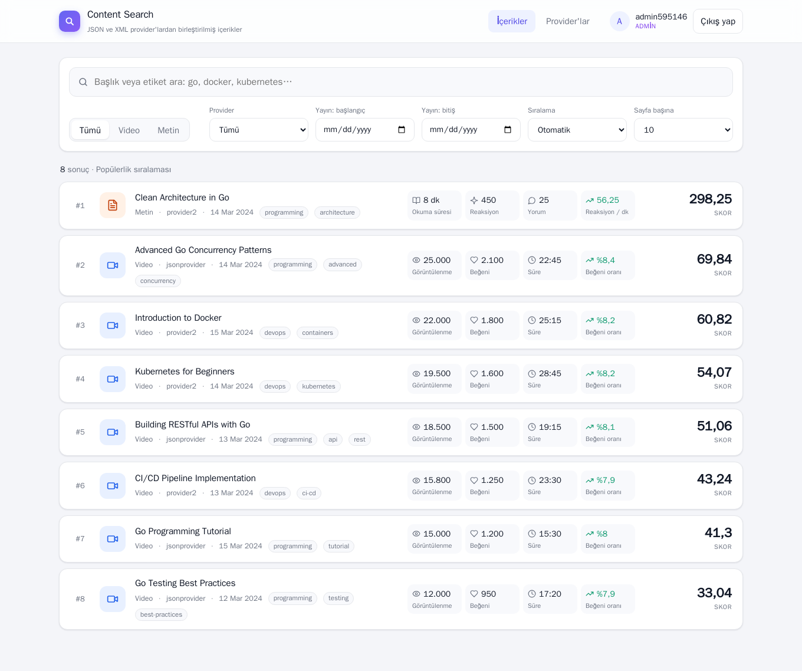

| Servis | Sorumluluk |
|---|---|
| **sse-gateway** | Tek giriş noktası. İstekleri sahibi olan servise yönlendirir. Middleware katmanında token doğrulama, rol kontrolü, kademeli rate limit, circuit breaker ve retry; ayrıca dashboard ve API dokümanı |
| **iam-service** | Kullanıcılar, şifreler, roller, access/refresh token'lar, oturum iptali |
| **sse-service** | Asıl iş mantığı: provider entegrasyonu, puanlama, arama, cache, senkronizasyon |

- **Dil / framework:** Go 1.26, Fiber v2
- **Veritabanı:** PostgreSQL 16; her servisin kendi veritabanı var
- **Cache ve paylaşılan durum:** Redis 7 (opsiyonel; yoksa servisler bellek içi çalışır)
- **Kimlik doğrulama:** JWT (RS256) access token, JWKS ile dağıtılan public key, rotasyonlu refresh token
- **İzleme:** Prometheus + Grafana, hazır dashboard'larla

---

## İçindekiler

- [Hızlı Başlangıç](#hızlı-başlangıç)
- [Mimari](#mimari)
- [Akışlar](#akışlar)
- [Veri Modeli](#veri-modeli)
- [API](#api)
- [Gateway Middleware Katmanı](#gateway-middleware-katmanı)
- [Kimlik Doğrulama ve Yetkilendirme](#kimlik-doğrulama-ve-yetkilendirme)
- [Provider Entegrasyonu](#provider-entegrasyonu)
- [Puanlama](#puanlama)
- [Arama ve Sıralama](#arama-ve-sıralama)
- [Cache Stratejisi](#cache-stratejisi)
- [Dashboard](#dashboard)
- [İzleme (Monitoring)](#izleme-monitoring)
- [Testler](#testler)
- [Konfigürasyon](#konfigürasyon)
- [Teknoloji Tercihleri ve Gerekçeleri](#teknoloji-tercihleri-ve-gerekçeleri)
- [Ölçeklenme Planı](#ölçeklenme-planı)
- [Bilinen Sınırlamalar ve Geliştirme Fikirleri](#bilinen-sınırlamalar-ve-geliştirme-fikirleri)

---

## Hızlı Başlangıç

Gereksinim: Docker (Compose v2).

```bash
make up          # ya da: docker compose up --build -d
```

| Adres | Açıklama |
|---|---|
| http://localhost:8080 | Dashboard (kayıt ol / giriş yap) |
| http://localhost:8080/docs | Swagger UI (OpenAPI 3) |
| http://localhost:8080/api/v1/... | API (gateway üzerinden) |
| http://localhost:8080/readyz | Gateway ve arkasındaki servislerin hazırlık durumu |
| http://localhost:3000 | Grafana: hazır dashboard'lar (giriş gerektirmez; düzenlemek için `admin` / `admin`) |
| http://localhost:9090 | Prometheus |

Dışarıya API olarak yalnızca gateway açılır. iam-service ve sse-service sadece compose ağı içinden erişilebilir. Servislerin metrik portları (`:9100`) da dışarı açılmaz; onları yalnızca Prometheus okur.

```bash
# Admin olarak kayıt ol ve token al
TOKEN=$(curl -s -X POST localhost:8080/api/v1/auth/register -H 'Content-Type: application/json' \
  -d '{"username":"alice","password":"s3cret-pass","role":"admin"}' | sed -n 's/.*"access_token":"\([^"]*\)".*/\1/p')

curl -H "Authorization: Bearer $TOKEN" 'localhost:8080/api/v1/contents?q=go&type=video'
curl -H "Authorization: Bearer $TOKEN" -X POST localhost:8080/api/v1/providers -H 'Content-Type: application/json' \
  -d '{"name":"my-feed","url":"https://example.com/feed.xml"}'      # format otomatik algılanır
curl -H "Authorization: Bearer $TOKEN" -X POST localhost:8080/api/v1/sync
```

Durdurmak için `make down` kullanılır (volume'leri de siler).

**Kalıcı imzalama anahtarı (opsiyonel):** `make keys` bir RSA anahtarı üretir. `.env` dosyasına `JWT_PRIVATE_KEY_FILE=/keys/jwt.pem` eklendiğinde iam-service yeniden başlasa bile verilmiş access token'lar geçerli kalır. Anahtar verilmezse her açılışta yeni bir anahtar üretilir; dashboard bu durumda token'ı refresh ederek devam eder.

### Lokal geliştirme

```bash
make deps               # sadece PostgreSQL (host:5433) ve Redis (host:6379)
make test               # tüm modüllerin unit testleri
make test-integration   # + gerçek PostgreSQL/Redis ile integration testler
make lint               # go vet + golangci-lint (her modül)
```

Postgres host'ta **5433** portundan açılır, böylece lokalde çalışan bir Postgres ile çakışmaz. Veritabanına pgAdmin gibi bir araçla `localhost:5433`, kullanıcı `app`, şifre `app` ile bağlanılabilir; veritabanları `contents` ve `iam`.

---

## Mimari

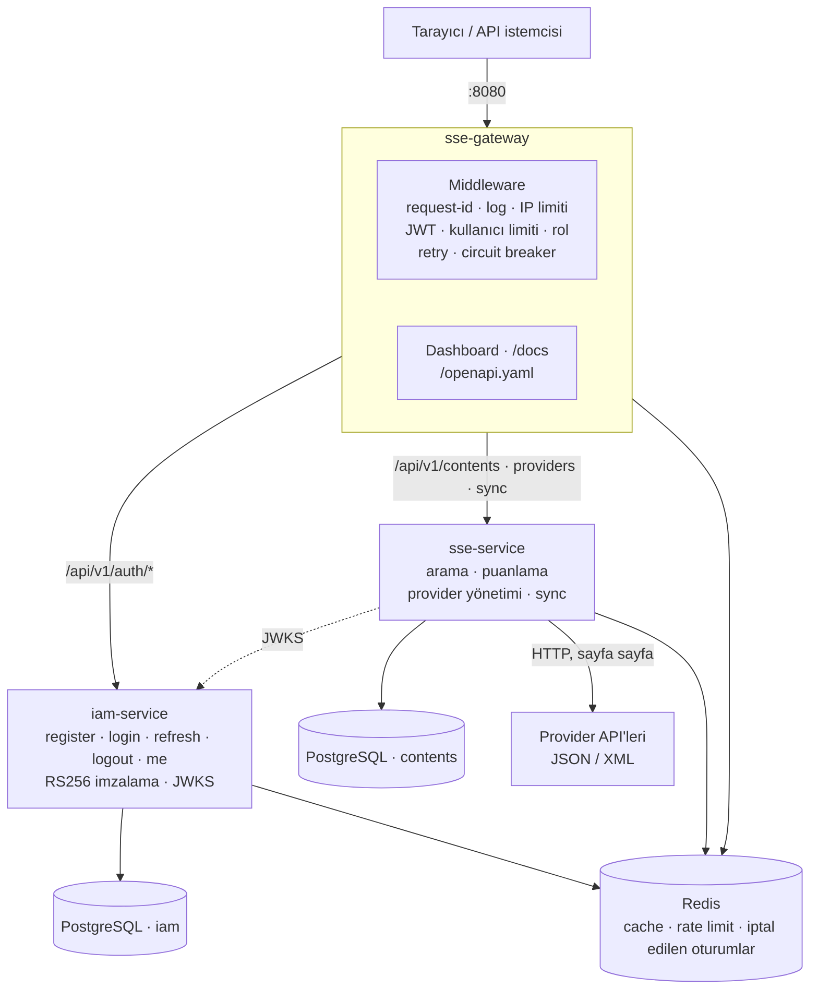

Gateway de token'ları doğrulamak için iam-service'in JWKS'ini kullanır (diyagramda sadeleştirmek için gösterilmedi). Prometheus her servisin iç ağdaki `:9100/metrics` adresini okur, Grafana da Prometheus'tan çizer (bkz. [İzleme](#izleme-monitoring)). Redis üç iş için kullanılır: sse-service için arama cache'i, gateway için rate limit sayaçları, iam-service, gateway ve sse-service için iptal edilmiş oturumlar listesi. Ayrıntılar: [Redis anahtarları](#redis-anahtarları).

### Temel kararlar

- **Gateway iş mantığı içermez.** Route tablosuna göre yönlendirir ve edge görevlerini bir middleware katmanında toplar: token doğrulama, kaba rol kontrolü, rate limit, circuit breaker ve retry; ayrıca `X-Forwarded-*` header'ları, request-id ve statik dosyalar. Tanımsız API path'leri hiçbir servise iletilmez. Ayrıntılar: [Gateway Middleware Katmanı](#gateway-middleware-katmanı).
- **Token iki kez doğrulanır (defense in depth).** iam-service access token'ları private key ile imzalar ve public key'leri `/.well-known/jwks.json` adresinde yayınlar. Gateway geçersiz token'lı ve yetkisiz istekleri servise ulaşmadan reddeder. sse-service aynı key'lerle her isteği yeniden doğrular ve rol kontrolünü kendisi de yapar. Böylece gateway'i atlayan ya da iç ağdan gelen bir istek de yetkisiz işlem yapamaz. Key'ler bellekte cache'lendiği için doğrulama ağ çağrısı gerektirmez.
- **Servisler birbirinden bağımsızdır.** Her servis ayrı bir Go modülüdür; kendi `pkg/` klasörü, kendi Dockerfile'ı ve kendi build context'i vardır. Ortak bir kütüphane modülü yoktur. Bu yüzden `httpx`, `jwtauth` ve `metrics` gibi küçük yardımcıların her serviste ayrı bir kopyası bulunur; karşılığında servisler bağımsız versiyonlanıp deploy edilebilir. Kökteki `go.work` yalnızca editör kolaylığı içindir; Docker build'leri onu kullanmaz.
- **Her servisin kendi veritabanı vardır.** Aynı PostgreSQL instance'ında `iam` ve `contents` adında iki ayrı veritabanı kullanılır; servisler birbirinin tablolarına erişmez.
- **API, provider'ları senkron çağırmaz.** Provider verisi arka planda çekilip veritabanına yazılır. Arama istekleri yalnızca veritabanına ve cache'e gider; bir provider düşse bile arama çalışır.

### Katmanlar ve klasör yapısı

Her serviste aynı katmanlı yapı kullanılır: **handler → service → repository**. Katmanlar birbirine interface'lerle bağlıdır (`ContentSearcher`, `Store`, `ProviderSource`, `Builder`, `Cache`, `Authenticator`); bu sayede her katman sahte implementasyonlarla izole test edilebilir. `cmd/server` her serviste üç dosyaya ayrılır: `main.go` (giriş), `boot.go` (bağımlılıkların kurulumu), `server.go` (sunucu ve graceful shutdown).

```
WingieCase/
├── sse-gateway/
│   ├── cmd/server/              main.go · boot.go · server.go
│   ├── internal/
│   │   ├── config/
│   │   ├── proxy/               route tablosu, upstream'e iletme (Forward/Mount, Guard arayüzü)
│   │   ├── http/middleware/     auth (JWT + rol), kademeli rate limit, resilience (circuit breaker + retry), metrikler
│   │   ├── http/router/
│   │   └── web/static/          dashboard (HTML + CSS + vanilla JS, binary'ye gömülü)
│   ├── openapi/                 tüm sistemin OpenAPI spec'i
│   └── pkg/                     httpx, metrics, ratelimit, jwtauth (doğrulama + iptal listesi)
├── iam-service/
│   ├── cmd/server/
│   ├── internal/
│   │   ├── config/  domain/
│   │   ├── auth/                register/login/refresh/logout, bcrypt, token rotasyonu (+ authtest: bellek içi store)
│   │   ├── repository/postgres/ users, refresh_tokens + migration'lar
│   │   ├── telemetry/           auth olay metrikleri (auth use case'ini saran decorator)
│   │   └── http/{handler,router}/
│   └── pkg/                     httpx, metrics, jwtauth (imzalama + doğrulama + JWKS + iptal listesi)
├── sse-service/
│   ├── cmd/server/
│   ├── internal/
│   │   ├── config/  domain/  scoring/
│   │   ├── provider/            Provider arayüzü, sayfalama, normalizasyon, jsonprovider, xmlprovider, registry
│   │   ├── ingest/              senkronizasyon
│   │   ├── repository/postgres/ contents, providers, sync_runs + migration'lar
│   │   ├── service/{search,providers}/
│   │   ├── telemetry/           arama, sync ve provider durum metrikleri
│   │   └── http/{handler,router}/
│   ├── pkg/                     cache, httpclient (rate limit + retry + circuit breaker), httpx, metrics, jwtauth
│   └── test/testdata/           gerçek provider yanıtlarından fixture'lar
├── deploy/                      postgres init script'i, (opsiyonel) imzalama anahtarı, prometheus, grafana
├── scripts/search-benchmark/    1 milyon kayıtlık arama ölçümü
├── docs/images/                 README ekran görüntüleri
└── docker-compose.yml · Makefile · go.work · .golangci.yml · .github/workflows/ci.yml
```

---

## Akışlar

### Bir API isteğinin yolculuğu

Örnek: bir viewer'ın arama isteği.

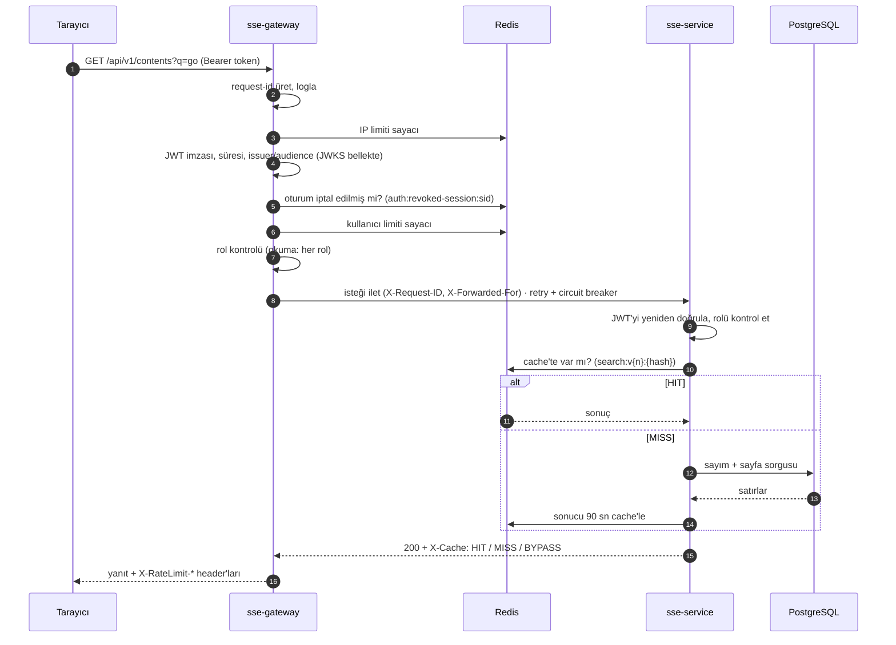

Herhangi bir adımda reddedilen istek servise hiç ulaşmaz: limit aşımı `429`, eksik ya da geçersiz token `401`, yetersiz rol `403`, devresi açık servis `503 upstream_unavailable` alır.

### Kayıt, giriş, refresh ve logout

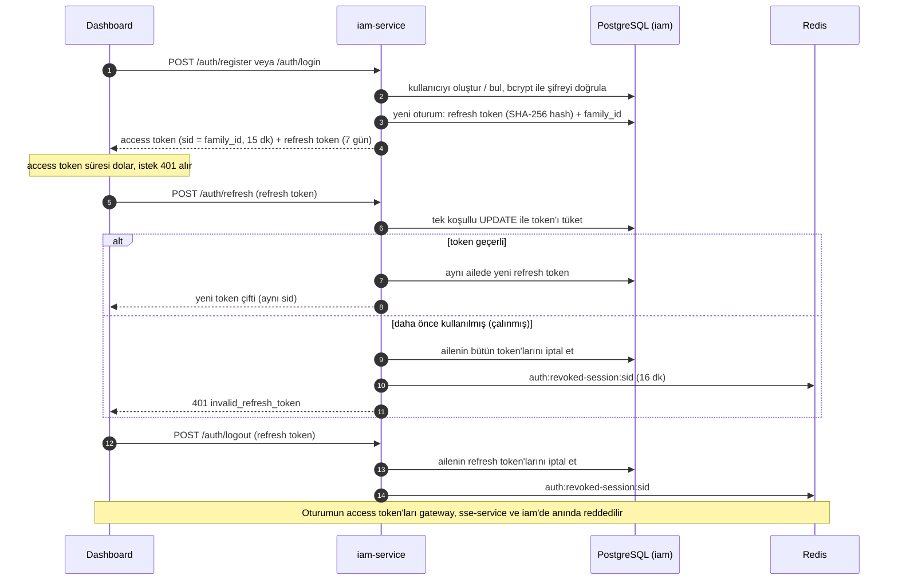

### Arama

1. **Doğrulama ve normalizasyon:** Kelime boşlukları sadeleştirilir; tür, etiket ve tarihler doğrulanır. `sort` verilmezse kelime varsa alakalılık, yoksa popülerlik seçilir.
2. **Cache:** Anahtar, global versiyon sayacı ve sorgunun bütün parametrelerinin SHA-256'sıdır. Aynı sorgu için eşzamanlı cache miss'ler `singleflight` ile tek bir veritabanı sorgusunda birleşir.
3. **Veritabanı:** Önce toplam sayım, sonra istenen sayfa. Görünürlük koşulu her sorguda uygulanır: provider etkin olmalı ve kayıt kaynakta silinmemiş olmalı.
4. **Yanıt:** Alakalılık sıralamasında her sonuç bir eşleşme yüzdesi (`match`) taşır; yanıt referans değeri `meta.best_relevance` olarak döner.

Ayrıntılar: [Arama ve Sıralama](#arama-ve-sıralama), [Cache Stratejisi](#cache-stratejisi).

### Senkronizasyon

sse-service açılışta ve her `SYNC_INTERVAL`'da (10 dk) bir sync çalıştırır; admin istediği zaman tüm provider'ları ya da tek bir provider'ı tetikleyebilir. Aynı anda tek bir sync çalışır; çakışan istek `409 sync_in_progress` alır.

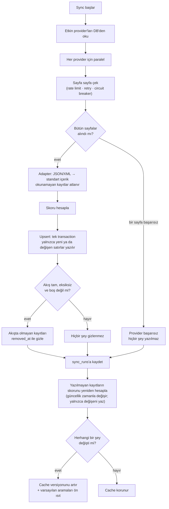

Bir provider'ın başarısız olması diğerlerini etkilemez. Ayrıntılar: [Provider Entegrasyonu](#provider-entegrasyonu).

### Provider ekleme

1. Admin ad ve URL girer; format boş ya da `auto` ise URL'den veri çekilir.
2. İçeriğin ilk karakterine bakılarak (`{`/`[` JSON, `<` XML) olası format önce denenir. Format ancak ilgili adapter en az bir geçerli içerik okuyabilirse kabul edilir; hiçbiri okuyamazsa istek `400 format_not_detected` ile reddedilir.
3. Provider kaydedilir. İçerikleri bir sonraki sync'te (ya da admin'in tetiklediği sync'te) gelir.

---

## Veri Modeli

### Veritabanları

| Veritabanı | Sahibi | Tablolar |
|---|---|---|
| `contents` | sse-service | `contents`, `providers`, `sync_runs`, `goose_db_version` |
| `iam` | iam-service | `users`, `refresh_tokens`, `goose_db_version` |

Veritabanları aynı PostgreSQL instance'ında durur. `iam` veritabanı, volume ilk oluşturulurken `deploy/postgres/init-databases.sql` ile açılır. Şema her servisin açılışında, binary'ye gömülü `goose` migration'larıyla kurulur ve güncellenir.

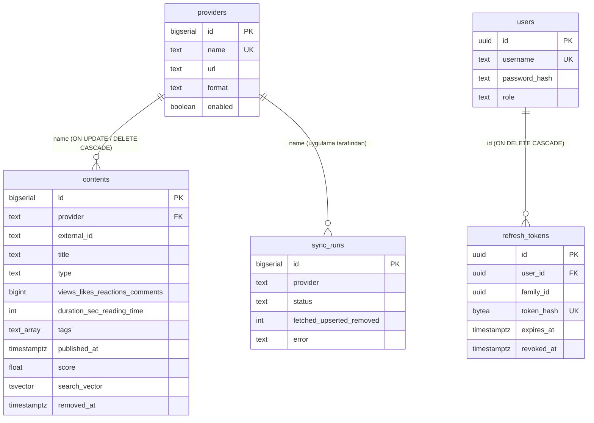

### Tablolar

#### `contents` (sse-service)
Provider'lardan gelen, standart formata çevrilmiş içerikler.

| Kolon | Tip | Kısıt / varsayılan | Açıklama |
|---|---|---|---|
| `id` | `BIGSERIAL` | PK | API'deki içerik kimliği |
| `provider` | `TEXT` | NOT NULL, FK → `providers.name` (ON UPDATE / ON DELETE CASCADE) | Kaynağın adı |
| `external_id` | `TEXT` | NOT NULL | Provider'daki kimlik; `(provider, external_id)` tekil |
| `title` | `TEXT` | NOT NULL | Başlık |
| `type` | `TEXT` | NOT NULL, `CHECK (type IN ('video','text'))` | `article` → `text` olarak eşlenir |
| `views`, `likes` | `BIGINT` | NOT NULL, 0, `>= 0` | Video metrikleri |
| `duration_sec` | `INTEGER` | NOT NULL, 0, `>= 0` | Video süresi (saniye) |
| `reading_time` | `INTEGER` | NOT NULL, 0, `>= 0` | Metin okuma süresi (dakika) |
| `reactions`, `comments` | `BIGINT` | NOT NULL, 0, `>= 0` | Metin metrikleri |
| `tags` | `TEXT[]` | NOT NULL, `'{}'` | Küçük harfli, tekil etiketler |
| `published_at` | `TIMESTAMPTZ` | NOT NULL | Yayın tarihi (UTC) |
| `score` | `DOUBLE PRECISION` | NOT NULL | Önceden hesaplanmış popülerlik skoru |
| `score_updated_at` | `TIMESTAMPTZ` | NOT NULL | Skorun hesaplandığı an |
| `raw_payload` | `JSONB` | | Provider'dan gelen ham kayıt (hata ayıklama, yeniden işleme) |
| `search_vector` | `TSVECTOR` | `GENERATED ALWAYS … STORED` | Başlık (ağırlık A) + etiketler (ağırlık B), `simple` sözlüğüyle |
| `removed_at` | `TIMESTAMPTZ` | NULL | Provider artık döndürmüyorsa dolu; kayıt aramada gizlenir |
| `created_at`, `updated_at` | `TIMESTAMPTZ` | NOT NULL, `now()` | |

`search_vector` generated column olduğu için uygulama onu hiç yazmaz; başlık ya da etiketler değişince PostgreSQL kendisi günceller. `array_to_string` yalnızca `STABLE` olduğundan generated column'da kullanılamaz; bu yüzden `IMMUTABLE` bir sarmalayıcı (`immutable_array_to_string`) tanımlıdır.

#### `providers` (sse-service)

| Kolon | Tip | Kısıt / varsayılan | Açıklama |
|---|---|---|---|
| `id` | `BIGSERIAL` | PK | |
| `name` | `TEXT` | NOT NULL, UNIQUE, `CHECK (name ~ '^[a-z0-9][a-z0-9_-]{1,49}$')` | 2–50 karakter: küçük harf, rakam, `-`, `_` |
| `url` | `TEXT` | NOT NULL, `CHECK (url ~* '^https?://')` | Beslemenin adresi |
| `format` | `TEXT` | NOT NULL, `CHECK (format IN ('json','xml'))` | Hangi adapter'ın okuyacağı |
| `enabled` | `BOOLEAN` | NOT NULL, `true` | Devre dışıysa sync edilmez, içerikleri gizlenir |
| `created_at`, `updated_at` | `TIMESTAMPTZ` | NOT NULL, `now()` | |

Case'teki iki provider migration ile eklenir (`provider1`: JSON, `provider2`: XML).

#### `sync_runs` (sse-service)
Her provider sync'inin sonucu; dashboard'daki "son senkronizasyon" bilgisi buradan gelir.

| Kolon | Tip | Kısıt / varsayılan | Açıklama |
|---|---|---|---|
| `id` | `BIGSERIAL` | PK | |
| `provider` | `TEXT` | NOT NULL | Provider adı (ad değişince uygulama günceller, silinince kayıtlar silinir) |
| `started_at`, `finished_at` | `TIMESTAMPTZ` | NOT NULL | |
| `status` | `TEXT` | NOT NULL, `CHECK (status IN ('success','failed'))` | |
| `fetched` | `INTEGER` | NOT NULL, 0 | Provider'dan alınan kayıt |
| `upserted` | `INTEGER` | NOT NULL, 0 | Eklenen ya da değişen kayıt (değişmeyenler yazılmaz) |
| `removed` | `INTEGER` | NOT NULL, 0 | Kaynakta silindiği için gizlenen kayıt |
| `error` | `TEXT` | | Başarısızlığın nedeni |

#### `users` (iam-service)

| Kolon | Tip | Kısıt / varsayılan | Açıklama |
|---|---|---|---|
| `id` | `UUID` | PK, `gen_random_uuid()` | Token'daki `sub` |
| `username` | `TEXT` | NOT NULL, UNIQUE, küçük harf, 3–32 karakter | Büyük/küçük harf duyarsız tekil |
| `password_hash` | `TEXT` | NOT NULL | bcrypt (cost 12) |
| `role` | `TEXT` | NOT NULL, `'viewer'`, `CHECK (role IN ('admin','viewer'))` | |
| `created_at`, `updated_at` | `TIMESTAMPTZ` | NOT NULL, `now()` | |

#### `refresh_tokens` (iam-service)

| Kolon | Tip | Kısıt / varsayılan | Açıklama |
|---|---|---|---|
| `id` | `UUID` | PK | |
| `user_id` | `UUID` | NOT NULL, FK → `users.id` (ON DELETE CASCADE) | |
| `family_id` | `UUID` | NOT NULL | Oturum kimliği: login'de yeni aile, refresh'te aynı aile; access token'daki `sid` |
| `token_hash` | `BYTEA` | NOT NULL, UNIQUE | Token'ın SHA-256'sı; token'ın kendisi saklanmaz |
| `expires_at` | `TIMESTAMPTZ` | NOT NULL | |
| `revoked_at` | `TIMESTAMPTZ` | | Kullanıldığında, logout'ta ya da aile iptal edildiğinde dolar |
| `created_at` | `TIMESTAMPTZ` | NOT NULL, `now()` | |

### Index'ler

| Index | Tablo | Tip | Kolonlar | Hangi sorgu için |
|---|---|---|---|---|
| `contents_pkey` | contents | B-tree | `id` | İçerik detayı |
| `contents_provider_external_id_key` | contents | B-tree, UNIQUE | `(provider, external_id)` | Upsert'in `ON CONFLICT` hedefi; provider bazlı işlemler (gizleme, sayım) |
| `contents_search_vector_idx` | contents | GIN | `search_vector` | Tam kelime araması (`search_vector @@ tsquery`) |
| `contents_title_trgm_idx` | contents | GIN (`gin_trgm_ops`) | `title` | Kelime parçası araması (`title ILIKE '%kuberne%'`) |
| `contents_score_idx` | contents | B-tree | `(score DESC, id)` | Popülerlik sıralaması: ilk sayfa index'ten okunur, tablo sıralanmaz |
| `contents_type_score_idx` | contents | B-tree | `(type, score DESC, id)` | Tür filtresi + popülerlik |
| `contents_tags_idx` | contents | GIN | `tags` | Etiket filtresi (`tags @> ARRAY['devops']`) |
| `providers_pkey` | providers | B-tree | `id` | Provider düzenleme / silme |
| `providers_name_key` | providers | B-tree, UNIQUE | `name` | Foreign key hedefi; her aramadaki "provider etkin mi" kontrolü |
| `sync_runs_pkey` | sync_runs | B-tree | `id` | |
| `sync_runs_provider_started_at_idx` | sync_runs | B-tree | `(provider, started_at DESC)` | Provider başına son çalışma (`DISTINCT ON`) |
| `users_pkey` | users | B-tree | `id` | `/me`, refresh sonrası kullanıcıyı yükleme |
| `users_username_key` | users | B-tree, UNIQUE | `username` | Login, tekillik |
| `refresh_tokens_pkey` | refresh_tokens | B-tree | `id` | |
| `refresh_tokens_token_hash_key` | refresh_tokens | B-tree, UNIQUE | `token_hash` | Refresh ve logout'ta token'ı bulma |
| `refresh_tokens_family_id_idx` | refresh_tokens | B-tree | `family_id` | Bir oturumun bütün token'larını iptal etme |
| `refresh_tokens_user_id_idx` | refresh_tokens | B-tree | `user_id` | Kullanıcı silinince cascade |

Bilinçli olarak eklenmeyenler: `published_at` (tarih filtresi) ve `removed_at` için index yok. Bugünkü veri boyutunda tarih filtresi diğer koşullarla birlikte çalışıyor. Veri büyürse `published_at` için bir B-tree ve `WHERE removed_at IS NULL` koşullu (partial) index'ler eklenmeli (bkz. [Ölçeklenme Planı](#ölçeklenme-planı)).

### Tutarlılık

- **Transaction'lar:** Bir provider'ın bütün kayıtları tek transaction'da yazılır; ya hepsi yazılır ya hiçbiri. Provider ad değişikliği ile sync geçmişinin taşınması ve silme ile sync geçmişinin silinmesi de tek transaction'dadır.
- **Kısıtlar:** Uygulamadaki doğrulamaların aynısı veritabanında `CHECK` olarak da vardır (tür, format, rol, provider adı, URL şeması, negatif olmayan metrikler). Uygulamada bir hata olsa bile geçersiz veri yazılamaz.
- **Foreign key'ler:** İçerikler provider'a adıyla bağlıdır. Provider'ın adı değişince içerikler kendiliğinden yeni ada taşınır (`ON UPDATE CASCADE`); provider silinince içerikleri de silinir (`ON DELETE CASCADE`).
- **Değişmeyen satır yazılmaz:** Upsert, satır aynıysa güncellemeyi atlar (`IS DISTINCT FROM`). Gereksiz yazma ve ölü satır oluşmaz; sync bir şeyin gerçekten değişip değişmediğini bilir.
- **Atomik token tüketimi:** Refresh token tek bir koşullu `UPDATE … WHERE revoked_at IS NULL` ile tüketilir. Aynı token'la eşzamanlı iki refresh'ten yalnızca biri başarılı olur.

### Migration'lar

| Servis | Migration | Ne yapar |
|---|---|---|
| sse | `00001_create_contents` | `pg_trgm`, `contents` tablosu, arama sütunu ve index'ler |
| sse | `00002_create_sync_runs` | Sync geçmişi |
| sse | `00003_create_providers` | Provider tablosu, iki provider'ın seed'i, `contents → providers` foreign key |
| sse | `00004_provider_rename_and_delete` | Foreign key'e `ON UPDATE / ON DELETE CASCADE` |
| sse | `00005_index_content_tags` | Etiket filtresi için GIN index |
| sse | `00006_content_removal` | `contents.removed_at`, `sync_runs.removed` |
| iam | `00001_create_users` | Kullanıcılar |
| iam | `00002_create_refresh_tokens` | Refresh token'lar ve index'leri |

### Redis anahtarları

| Anahtar | Sahibi | Değer | Süre | Amaç |
|---|---|---|---|---|
| `search:version` | sse-service | sayaç | kalıcı | Cache versiyonu; artırılınca bütün cache'lenmiş aramalar geçersizleşir |
| `search:v{n}:{sha256}` | sse-service | arama sonucunun JSON'u | 90 sn (`CACHE_TTL`) | Arama cache'i |
| `ratelimit:{kademe}:{anahtar}` | sse-gateway | sayaç | pencere süresi (1 dk) | Rate limit sayaçları; kademe `ip`, `auth`, `user` ya da `sync`, anahtar IP ya da kullanıcı kimliği |
| `auth:revoked-session:{sid}` | iam-service yazar; gateway, sse ve iam okur | `1` | access token ömrü + 1 dk | İptal edilmiş oturumlar |

Redis'e ulaşılamazsa hiçbiri sistemi durdurmaz: arama veritabanından yapılır (`BYPASS`), rate limit ve iptal kontrolleri "fail-open" çalışır ve durum loglanır.

---

## API

Tüm uç noktalar gateway üzerinden (`:8080`) sunulur. Tam şema: [`sse-gateway/openapi/openapi.yaml`](sse-gateway/openapi/openapi.yaml) ya da çalışan sistemde `/docs`.

| Metot | Yol | Yetki | Servis | Açıklama |
|---|---|---|---|---|
| `POST` | `/api/v1/auth/register` | public | iam | Kullanıcı oluşturur, token çifti döner |
| `POST` | `/api/v1/auth/login` | public | iam | Yeni oturum açar, token çifti döner |
| `POST` | `/api/v1/auth/refresh` | public | iam | Refresh token'ı yenisiyle değiştirir |
| `POST` | `/api/v1/auth/logout` | public | iam | Oturumu (refresh ve access token'larıyla) kapatır |
| `GET` | `/api/v1/auth/me` | token | iam | Oturumdaki kullanıcı |
| `GET` | `/api/v1/contents` | token | sse | Arama, filtreler, sıralama, sayfalama |
| `GET` | `/api/v1/contents/{id}` | token | sse | İçerik detayı + skor kırılımı; `?q=` ile alakalılık kırılımı |
| `GET` | `/api/v1/providers` | token | sse | Provider listesi |
| `POST` | `/api/v1/providers` | admin | sse | Provider ekler (format otomatik algılanabilir) |
| `PATCH` | `/api/v1/providers/{id}` | admin | sse | Ad, URL, format, etkinlik |
| `DELETE` | `/api/v1/providers/{id}` | admin | sse | Provider'ı içerikleri ve geçmişiyle siler |
| `POST` | `/api/v1/providers/{id}/sync` | admin | sse | Tek provider'ı senkronize eder |
| `POST` | `/api/v1/sync` | admin | sse | Bütün etkin provider'ları senkronize eder |
| `GET` | `/api/v1/sync/runs` | token | sse | Provider başına son sync sonucu |
| `GET` | `/healthz`, `/readyz` | public | hepsi | Canlılık ve hazırlık |

**Yanıt zarfı:** Başarılı yanıtlar `{"data": …}` ve listelerde `"meta"` taşır; hatalar her serviste aynı biçimdedir: `{"error": {"code": "...", "message": "..."}}`. `500` yanıtlarında iç hata ayrıntısı istemciye sızdırılmaz; ayrıntı, istekle aynı `X-Request-ID`'yi taşıyan logda bulunur.

<details>
<summary>Örnek: <code>GET /api/v1/contents?q=programming&per_page=2</code></summary>

```json
{
  "data": [
    {
      "id": 1, "provider": "provider1", "external_id": "v1", "title": "Go Programming Tutorial",
      "type": "video", "score": 41.3, "relevance": 0.7295, "match": 100,
      "metrics": { "views": 15000, "likes": 1200, "duration_sec": 930 },
      "tags": ["programming", "tutorial"], "published_at": "2024-03-15T10:00:00Z"
    },
    {
      "id": 8, "provider": "provider2", "external_id": "a1", "title": "Clean Architecture in Go",
      "type": "text", "score": 298.25, "relevance": 0.4863, "match": 67,
      "metrics": { "reading_time": 8, "reactions": 450, "comments": 25 },
      "tags": ["programming", "architecture"], "published_at": "2024-03-14T00:00:00Z"
    }
  ],
  "meta": { "page": 1, "per_page": 2, "total": 5, "total_pages": 3, "sort": "relevance", "best_relevance": 0.7295 }
}
```
</details>

**Hata kodları:**

| HTTP | `code` | Ne zaman |
|---|---|---|
| 400 | `invalid_input` | Geçersiz parametre, hatalı tarih, ters tarih aralığı, geçersiz provider adı/URL |
| 400 | `format_not_detected` | Provider URL'sindeki veri desteklenen hiçbir şemaya uymuyor |
| 400 | `provider_unreachable` | Provider URL'sine ulaşılamadı (format algılarken) |
| 401 | `unauthorized` | Token yok |
| 401 | `invalid_token` | Token geçersiz, süresi dolmuş ya da oturumu iptal edilmiş |
| 401 | `invalid_credentials` | Kullanıcı adı veya şifre hatalı |
| 401 | `invalid_refresh_token` | Refresh token geçersiz, süresi dolmuş ya da daha önce kullanılmış |
| 403 | `forbidden` | Rol yetersiz |
| 404 | `not_found` | Kayıt yok (ya da provider'ı devre dışı / kaynakta silinmiş) |
| 409 | `conflict` | Bu adla bir provider zaten var |
| 409 | `username_taken` | Kullanıcı adı alınmış |
| 409 | `sync_in_progress` | Başka bir sync çalışıyor |
| 429 | `rate_limited` | Limit aşıldı; `Retry-After` kaç saniye bekleneceğini söyler |
| 502 | `bad_gateway` | Servise bağlanılamadı |
| 503 | `upstream_unavailable` | Servisin devresi açık; `Retry-After` ile |
| 503 | `auth_unavailable` | Token doğrulama anahtarları alınamıyor |
| 504 | `gateway_timeout` | Servis zamanında yanıt vermedi |

---

## Gateway Middleware Katmanı

Kesişen (cross-cutting) edge görevleri `sse-gateway/internal/http/middleware` paketinde toplanır. Bir API isteği şu sırayla işlenir:

```
request-id → log → IP limiti → [public auth endpoint'leri: auth limiti]
                             → JWT doğrulama → kullanıcı limiti → rol kontrolü → [sync: sync limiti]
                             → retry → circuit breaker → upstream
```

Sıranın gerekçeleri:
- **IP limiti en başta:** Token doğrulamadan önce kaba bir sel koruması sağlar.
- **Kullanıcı limiti doğrulamadan sonra:** Anahtarı token'daki `sub`, yani doğrulanmış kullanıcı kimliğidir. Doğrulanmamış bir token'dan okunan `sub`'a güvenilseydi uydurma `sub`'larla sınırsız kota açılabilirdi.
- **Kullanıcı limiti rol kontrolünden önce:** Yetkisiz denemeler de kullanıcının kotasından düşer.
- **Retry dışta, breaker içte:** Her deneme breaker tarafından sayılır, devre açıldığı anda retry de durur.

### Kimlik doğrulama ve yetkilendirme

| Endpoint | Gateway'deki kural |
|---|---|
| `POST /auth/login`, `/auth/register`, `/auth/refresh`, `/auth/logout` | Public (token almanın yolu bunlar) |
| `GET /auth/me`, `/contents/*`, `GET /providers`, `GET /sync/runs` | Geçerli token |
| `POST`/`PATCH`/`DELETE` `/providers/*`, `POST /sync` | Geçerli token + `admin` |

Gateway yalnızca kaba kuralları uygular; iş kuralına bağlı yetki kontrolleri servislerde kalır ve sse-service token'ı yeniden doğrular. Token yoksa veya geçersizse `401`, rol yetmiyorsa `403` döner. JWKS'e ulaşılamıyorsa ve key cache'te de yoksa `503 auth_unavailable` döner.

### Kademeli rate limit

| Kademe | Anahtar | Varsayılan | Kapsam |
|---|---|---|---|
| IP | İstemci IP'si | 300 / dk | Tüm `/api` istekleri, doğrulamadan önce |
| Auth | İstemci IP'si | 10 / dk | login, register, refresh (brute-force'a karşı; henüz token yok) |
| Kullanıcı | Token'daki `sub` | 100 / dk | Token'lı tüm istekler |
| Sync | Token'daki `sub` | 5 / dk | `POST /sync` ve `POST /providers/{id}/sync` (her sync tüm provider'ları çeker) |

- **Anahtar token değil kullanıcı:** Token anahtar olsaydı kullanıcı refresh ile yeni token alıp sayacını sıfırlayabilirdi. `sub` refresh'ten sonra da aynı kalır. Aynı NAT arkasındaki kullanıcılar da tek bir IP kotasını paylaşmaz.
- **Header'lar:** Yanıtlarda `X-RateLimit-Limit`, `X-RateLimit-Remaining` ve `X-RateLimit-Reset` bulunur. Birden fazla limit uygulandığında header'lar en sıkı olanı gösterir. Limit aşılınca `429 rate_limited` ve `Retry-After` döner; dashboard kaç saniye beklenmesi gerektiğini gösterir.
- **Paylaşım:** Sayaçlar Redis'te tutulur, bu yüzden tüm gateway instance'ları aynı limiti paylaşır. Redis'e ulaşılamazsa fail-open çalışır.

### Circuit breaker

Her upstream servisin (iam-service, sse-service) ayrı bir breaker'ı vardır ([sony/gobreaker](https://github.com/sony/gobreaker)). Böylece bir servisin çökmesi diğerine giden trafiği etkilemez.

- **Hata sayılan durumlar:** Bağlantı hataları, timeout'lar ve upstream'in `502/503/504` yanıtları. `500` ve `4xx` hata sayılmaz; servis ayakta ve cevap veriyor demektir.
- **Açılma:** `BREAKER_FAILURE_THRESHOLD` (5) ardışık hatadan sonra devre açılır. Açık devrede istekler upstream'e hiç gitmez; milisaniyeler içinde `503 upstream_unavailable` ve `Retry-After` döner. Böylece hem istemci timeout kadar beklemez hem de toparlanmaya çalışan servise yük binmez.
- **Toparlanma:** `BREAKER_OPEN_TIMEOUT` (30 sn) sonra devre yarı açık duruma geçer ve bir deneme isteği geçirilir. Deneme başarılıysa devre kapanır, başarısızsa yeniden açılır.
- **İzleme:** Durum değişiklikleri loglanır; açık devreler `/readyz` çıktısında `circuit:<servis>` olarak ve Grafana'da görünür.

### Retry ve exponential backoff

Gateway'de retry kasıtlı olarak dar tutuldu, çünkü yanlış kullanıldığında zarar verir:

- **Sadece `GET` ve `HEAD` istekleri tekrar denenir.** Login, register, refresh, sync ve provider ekleme denenmez. İlk istek servise ulaşmış ama yanıt kaybolmuş olabilir. Refresh'i tekrar göndermek token'ın "tekrar kullanıldığı" sanılmasına ve oturumun kapanmasına, sync'i tekrarlamak işin iki kez yapılmasına yol açar.
- **Sadece geçici ve hızlı hatalarda denenir:** bağlantı hatası, `502` ve `503`. Timeout'lar (bağlantı kurulurken olanlar dahil) denenmez; zaman bütçesi zaten tükenmiştir.
- **En fazla `UPSTREAM_MAX_RETRIES` (2) ek deneme yapılır.** Bekleme süresi her denemede ikiye katlanır (100 ms, 200 ms, …, en fazla 1 sn). Süreye *full jitter* uygulanır, yani 0 ile bu üst sınır arasında rastgele bir süre beklenir; aynı anda hata alan istemciler toparlanan servise hep birlikte yüklenmez.
- **Devre açıksa hiç denenmez.**

Provider'lara giden istekler gateway'den geçmez. Onların rate limit, retry, backoff ve circuit breaker'ı sse-service'teki `pkg/httpclient` içinde ayrıca uygulanır (bkz. [Provider Entegrasyonu](#provider-entegrasyonu)).

---

## Kimlik Doğrulama ve Yetkilendirme

### Akış

1. **Register** (`POST /api/v1/auth/register`): Kullanıcı adı, şifre ve rol (`viewer` varsayılan, ya da `admin`) gönderilir. Yanıtta kullanıcı bilgisiyle birlikte `access_token` ve `refresh_token` döner.
2. **Login** (`POST /api/v1/auth/login`): Aynı yanıt döner. Her login yeni bir oturum (refresh token ailesi) başlatır.
3. API çağrıları `Authorization: Bearer <access_token>` header'ı ile yapılır.
4. Access token'ın süresi dolduğunda (15 dk) `POST /api/v1/auth/refresh` çağrılır. Gönderilen refresh token iptal edilir, yerine yeni bir çift verilir.
5. **Logout** (`POST /api/v1/auth/logout`): O oturumun bütün refresh token'larını iptal eder; oturumun access token'ları da anında geçersiz olur.

Sıra diyagramı: [Kayıt, giriş, refresh ve logout](#kayıt-giriş-refresh-ve-logout).

### Token tasarımı

| | Access token | Refresh token |
|---|---|---|
| Biçim | JWT, **RS256** imzalı. Claim'ler: `sub` (user id), `username`, `role`, `sid` (oturum), `iss`, `aud`, `exp`, `jti` | 256 bit rastgele, opaque |
| Ömür | 15 dakika (`ACCESS_TOKEN_TTL`) | 7 gün (`REFRESH_TOKEN_TTL`) |
| Saklama | Saklanmaz, imza ile doğrulanır; iptal edilen oturumlar Redis'te kısa süreli bir listede | DB'de sadece **SHA-256 hash**'i tutulur |
| Doğrulayan | Her servis, JWKS'ten aldığı public key ile | Sadece iam-service |

- **Neden RS256 ve JWKS:** Simetrik bir imzada (HS256) token'ı doğrulayan her servis aynı zamanda token üretebilirdi. Asimetrik imzada private key yalnızca iam-service'te durur; diğer servisler sadece doğrulayabilir. `kid` header'ı sayesinde key rotasyonu yapılabilir: bilinmeyen bir `kid` görüldüğünde JWKS yeniden çekilir. Bu yeniden çekme rate limitlidir, böylece rastgele `kid`'li token'larla iam-service'e yük bindirilemez. iam-service erişilemezse bu durum "geçersiz token" değil `503 auth_unavailable` olarak bildirilir.
- **Refresh token rotasyonu ve tekrar kullanım tespiti:** Her refresh işleminde eski token tek bir koşullu `UPDATE` ile iptal edilir; böylece aynı token'la eşzamanlı yapılan iki refresh'ten yalnızca biri başarılı olur. Daha önce kullanılmış bir token tekrar gelirse token'ın çalındığı varsayılır ve o oturumdaki **tüm** token'lar iptal edilir.
- **Access token iptali:** Access token'lar saklanmadığı için normalde süreleri dolana kadar (15 dk) geçerli kalırdı. Bu açığı kapatmak için her token, ait olduğu oturumun kimliğini (`sid`, refresh token ailesinin kimliği) taşır.
  - **Ne zaman iptal edilir:** Logout'ta ve çalınmış refresh token tespit edildiğinde iam-service oturumu Redis'teki `auth:revoked-session:<sid>` listesine yazar.
  - **Kim kontrol eder:** Gateway, sse-service ve iam-service token doğrularken bu listeye bakar; o oturumun bütün access token'ları anında reddedilir (`401 invalid_token`). Dashboard bu durumda refresh dener, refresh de iptal edildiği için oturum kapanır.
  - **Neden tek tek token değil oturum:** Dashboard logout'ta sadece refresh token gönderir. Refresh token'dan oturum bulunur ve tek bir kayıtla o oturumdaki bütün access token'lar (refresh ile yenilenmiş olanlar dahil) geçersiz olur. Çalınmış refresh token senaryosunda saldırganın elindeki access token da böylece iptal edilir.
  - **Liste küçük kalır:** Kayıt, access token ömrü + 1 dakika (doğrulayıcıların saat toleransı) sonra kendiliğinden silinir; o noktada oturumun bütün token'larının süresi zaten dolmuştur.
  - **Redis erişilemezse:** Kontrol "fail-open" çalışır, yani token kabul edilir ve durum loglanır. Aksi halde bir Redis kesintisi bütün sistemi kilitlerdi; risk access token ömrüyle sınırlı kalır. Redis yoksa (`REDIS_URL` boş) iptal devre dışıdır; refresh token'lar yine DB'de iptal edilir.
  - **Maliyet:** Kimliği doğrulanmış her istek gateway'de ve sse-service'te birer Redis `EXISTS` çağrısı yapar.
- **Şifreler:** bcrypt ile saklanır (cost 12, `BCRYPT_COST`). Şifre uzunluğu 8–72 byte arasında olmalı; bcrypt 72 byte'tan sonrasını yok saydığı için üst sınır bu. Var olmayan bir kullanıcı adıyla login denendiğinde de sahte bir hash ile karşılaştırma yapılır; böylece yanıt süresinden hangi kullanıcı adlarının kayıtlı olduğu anlaşılamaz.
- **Kullanıcı adları:** Küçük harfe çevrilerek saklanır ve büyük/küçük harf duyarsız olarak tekildir.

### Roller

| İşlem | viewer | admin |
|---|:-:|:-:|
| İçerik arama, filtreleme, detay (`GET /contents`, `/contents/{id}`) | ✓ | ✓ |
| Provider listesi, son sync durumları (`GET /providers`, `/sync/runs`) | ✓ | ✓ |
| Provider ekleme / düzenleme / silme (`POST /providers`, `PATCH`/`DELETE /providers/{id}`) | | ✓ |
| Sync tetikleme (`POST /sync`, `POST /providers/{id}/sync`) | | ✓ |

**Rol tipi:** Go'da string tabanlı bir enum (`type Role string`, sabitler `RoleAdmin`/`RoleViewer`), veritabanında `TEXT` ve `CHECK (role IN ('admin','viewer'))` olarak tutulur.
- Integer'a göre JWT'de, JSON'da ve DB'de okunabilir; numaralandırma derdi yok.
- PostgreSQL `ENUM` tipine göre yeni bir rol eklemek tek satırlık bir `CHECK` değişikliği; ENUM'dan değer silmek ise zor.
- Geçersiz değerler hem uygulamada (`ParseRole`) hem DB'de reddedilir.

> ⚠️ **Rol seçimi bilinçli olarak serbest.** İstendiği gibi register isteğinde rol serbestçe seçilebiliyor; yani herkes kendini admin olarak kaydedebilir. Bu demo için kabul edilebilir, ama gerçek bir sistemde public register'ın her zaman `viewer` oluşturması, admin yetkisinin ise ayrı bir kanaldan verilmesi gerekir (davet kodu, mevcut bir admin'in onayı ya da başlangıçta oluşturulan bir admin hesabı).

---

## Provider Entegrasyonu

Provider'lar sse-service'in `providers` tablosunda tutulur. Case'teki iki provider migration ile seed edilir. Admin, dashboard'dan ya da API'den provider ekleyebilir; adını, URL'sini ve formatını düzenleyebilir; etkinleştirip devre dışı bırakabilir; silebilir; tek tek ya da toplu sync tetikleyebilir. Bunlar için kod değişikliği ya da restart gerekmez: her sync, etkin provider'ları DB'den okur.

**Format algılama:** Format verilmezse (ya da `auto` seçilirse) URL'den veri çekilir. Önce içeriğin ilk karakterine bakılır (`{`/`[` JSON, `<` XML); böylece tahmin edilen format önce denenir. Format, ilgili adapter en az bir geçerli içerik okuyabiliyorsa kabul edilir. Yani "JSON'a benziyor" yetmez, şemaya da uymalıdır. Hiçbir adapter okuyamıyorsa (ör. bir HTML sayfası ya da farklı şemada bir JSON) istek `400` ile reddedilir. Düzenlemede URL değişir ve format açıkça verilmezse format yeniden algılanır.

**Ad değiştirme ve silme:** İçerikler provider'a adıyla bağlı (`ON UPDATE CASCADE ON DELETE CASCADE`). Ad değişince içerikler ve sync geçmişi tek bir transaction'da yeni ada taşınır. Provider silindiğinde ona ait içerikler ve sync geçmişi de silinir; dashboard bu yüzden silmeden önce onay ister. Her iki işlem de arama cache'ini anında geçersiz kılar.

**Devre dışı bırakma:** Devre dışı bir provider sync edilmez; içerikleri arama sonuçlarında ve içerik detayında gösterilmez. İçerikler silinmez; provider tekrar etkinleştirildiğinde hemen geri gelir. Bu değişiklik de arama cache'ini anında geçersiz kılar.

**Format = adapter.** `format` alanı payload'ı okuyacak adapter'ı seçer:

| | `json` (provider1 şeması) | `xml` (provider2 şeması) |
|---|---|---|
| Başlık | `title` | `headline` |
| Metrikler | `metrics{views, likes, duration}` | `stats{views, likes, duration \| reading_time, reactions, comments}` |
| Tür | `video` / `text` / `article` | `video` / `text` / `article` |
| Tarih | RFC3339 | `YYYY-MM-DD` |
| Etiketler | `tags[]` | `categories>category` |
| Sayfalama | `pagination{total, page, per_page}` | `meta{total_count, current_page, items_per_page}` |

Yeni eklenen bir provider, seçtiği formatın şemasına uyan veri döndürmelidir. Tamamen farklı bir şema için yeni bir adapter yazılıp `internal/provider/registry` içinde kaydedilir; o formatı kullanan provider'lar da çalışma anında eklenebilir hale gelir.

**Normalizasyon kuralları:**
- `article` türü `text` olarak eşlenir.
- Süre `mm:ss` / `hh:mm:ss` formatından saniyeye çevrilir.
- Tarihler UTC'ye çevrilir.
- Etiketler küçük harfe çevrilip tekilleştirilir.
- Geçersiz kayıtlar loglanıp atlanır; tek bir bozuk kayıt bütün beslemeyi durdurmaz.

**ID çakışması:** Tekillik `(provider, external_id)` çifti üzerinden sağlanır, çünkü iki provider da `v1`, `v2`, `v3` ID'lerini kullanıyor.

**Sayfalama:**
- Provider'lar sayfa sayfa çekilir. İlk istek admin'in girdiği URL'ye gider; sonraki sayfalar için URL'ye `page=2`, `page=3`… eklenir, URL'deki diğer parametreler korunur.
- Her sayfa isteği provider'ın rate limit'inden, retry'ından ve circuit breaker'ından geçer.
- Bir sayfa bile başarısız olursa o provider'ın sync'i başarısız sayılır ve hiçbir şey yazılmaz. Böylece veritabanında yarım bir besleme olmaz.
- **Ne zaman durulur:**
  - Provider bir toplam bildiriyorsa (`pagination.total`, `meta.total_count`) o kadar kayıt alınınca akış tamamdır.
  - Toplam bildirmiyorsa kısa ya da boş bir sayfa son sayfadır.
  - Toplama ulaşılmadan boş sayfa gelirse ya da `PROVIDER_MAX_PAGES` (50) sınırına varılırsa, alınanlar yazılır ama akış "eksik" sayılır.
- **Sayfa parametresini yok sayan provider'lar:** Statik dosyalar (ör. case'teki mock'lar) `page=2` isteğine yine ilk sayfayla cevap verir. Bu, dönen sayfa numarasından ya da tekrar eden kayıtlardan anlaşılır. Fetch o noktada durur: aynı kayıtlar mükerrer yazılmaz ve akış eksik sayılır (mock 150 kayıt bildiriyor ama 4 tane veriyor).

**İstek limiti yönetimi:**
- Her provider'ın kendi HTTP client'ı ve token bucket'ı var (`PROVIDER_RATE_PER_SEC`). Client provider başına cache'lenir, URL değişince yenisi oluşturulur.
- Ağ hataları, `429` ve `5xx` yanıtları exponential backoff ile yeniden denenir; `429`'da `Retry-After` header'ına uyulur.
- Yanıt boyutu 10 MB ile sınırlı.

**Circuit breaker (provider başına):**
- Sürekli hata veren bir provider'a her sync'te tekrar tekrar istek atmak hem zaman kaybı hem de o provider'a gereksiz yük. Bu yüzden her provider'ın HTTP client'ında bir breaker var.
- `PROVIDER_BREAKER_FAILURE_THRESHOLD` (5) ardışık başarısız istekten sonra devre açılır. Retry denemeleri de tek tek sayılır; devre açıldığı anda retry'lar da durur.
- Açık devrede sync o provider'ı ağ isteği yapmadan atlar ve `sync_runs`'a "circuit open" hatasıyla kaydeder; diğer provider'lar etkilenmez.
- `PROVIDER_BREAKER_OPEN_TIMEOUT` (15 dk) dolunca tek bir deneme isteği yapılır; başarılıysa devre kapanır. Süre `SYNC_INTERVAL`'dan (10 dk) uzun seçildi ki en az bir periyodik sync provider'ı atlasın.
- Breaker provider ve URL başınadır: admin bozuk URL'yi düzelttiğinde yeni URL kapalı bir devreyle başlar. Format algılama breaker kullanmaz. İptal edilen bir sync hata sayılmaz.
- Breaker durumu bellekte tutulur; servis yeniden başlarsa devreler kapalı başlar. Tek instance için yeterli.

**Kaynakta silinen içerik:**
- Provider bir kaydı artık döndürmüyorsa, kayıt bizde de aramadan ve detaydan kalkar. Kayıt silinmez, `removed_at` ile işaretlenir; provider onu tekrar döndürürse upsert işareti kaldırır ve kayıt kendiliğinden geri gelir.
- **Yalnızca güvenilir bir akıştan sonra yapılır.** Üç koşulun hepsi sağlanmalı:
  - akış tam olmalı: bütün sayfalar alınmış olmalı (bkz. sayfalama);
  - hiçbir kayıt okunamadığı için atlanmamış olmalı (atlanan kayıt kaynakta hâlâ var, sadece okunamadı);
  - akış boş olmamalı (boş bir akış genelde provider'ın bozulduğunu gösterir, her şeyi sildiğini değil).
- Bu koşullardan biri sağlanmazsa hiçbir şey gizlenmez ve durum loglanır. Case'in mock'ları 150 kayıt bildirip 4 tane verdiği için eksik sayılır; onlardan hiçbir şey gizlenmez.
- Gizlenen kayıt sayısı her çalışmada `sync_runs.removed` alanına ve `sync_items_removed_total` metriğine yazılır; dashboard'daki provider tablosu da "· 2 kaldırıldı" şeklinde gösterir.
- Gizlenen kayıtlar arama sonuçlarında, detayda, içerik sayılarında ve skor yeniden hesaplamasında yer almaz.

**Hata izolasyonu:**
- Provider'lar paralel çekilir; biri başarısız olsa bile diğerlerinin verisi yazılır.
- Her çalışmanın sonucu `sync_runs` tablosuna kaydedilir.
- Aynı anda tek bir sync çalışabilir; çakışan istek `409 sync_in_progress` alır.
- Devre dışı bir provider tek başına sync edilmek istenirse `400` döner.

> Not: Admin'ler istedikleri URL'yi ekleyebildiği için sse-service bu adreslere istek atar (SSRF yüzeyi). URL şeması `http`/`https` ile sınırlı. Üretimde iç ağ adreslerinin engellenmesi ya da bir allowlist kullanılması önerilir.

---

## Puanlama

```
Final Skor = (Temel Puan × İçerik Türü Katsayısı) + Güncellik Puanı + Etkileşim Puanı
```

| | Video | Metin |
|---|---|---|
| Temel puan | `views/1000 + likes/100` | `reading_time + reactions/50` |
| Katsayı | 1.5 (`SCORE_VIDEO_COEFFICIENT`) | 1.0 (`SCORE_TEXT_COEFFICIENT`) |
| Etkileşim | `(likes/views) × 10` | `(reactions/reading_time) × 5` |
| Güncellik | ≤7 gün +5, ≤30 gün +3, ≤90 gün +1, daha eski 0 | aynı |

- Skor ingest sırasında hesaplanıp `score` kolonunda saklanır; popülerlik sıralaması index üzerinden yapılır.
- Güncellik puanı zamana bağlı olduğu için her sync'te, o sync'in yazmadığı kayıtların skorları da yeniden hesaplanır; yalnızca gerçekten değişen skorlar yazılır.
- Sıfıra bölme korunur (görüntülenmesi ya da okuma süresi 0 olan içerikte etkileşim 0).
- Formül tek bir kural tablosunda tanımlıdır. Skoru hesaplayan kod, açıklamayı da aynı adımlarda üretir; bu yüzden gösterilen hesap gerçek hesapla hiçbir zaman ayrışamaz.

**Skor kırılımı:** `GET /api/v1/contents/{id}` her bileşenin nasıl hesaplandığını döndürür: temel puanı oluşturan terimler (metrik ÷ sabit = sonuç), etkileşim oranının pay, payda ve çarpanı, içeriğin yaşı ve hangi güncellik kademesine düştüğü. Dashboard bunu detay penceresinde gösterir:

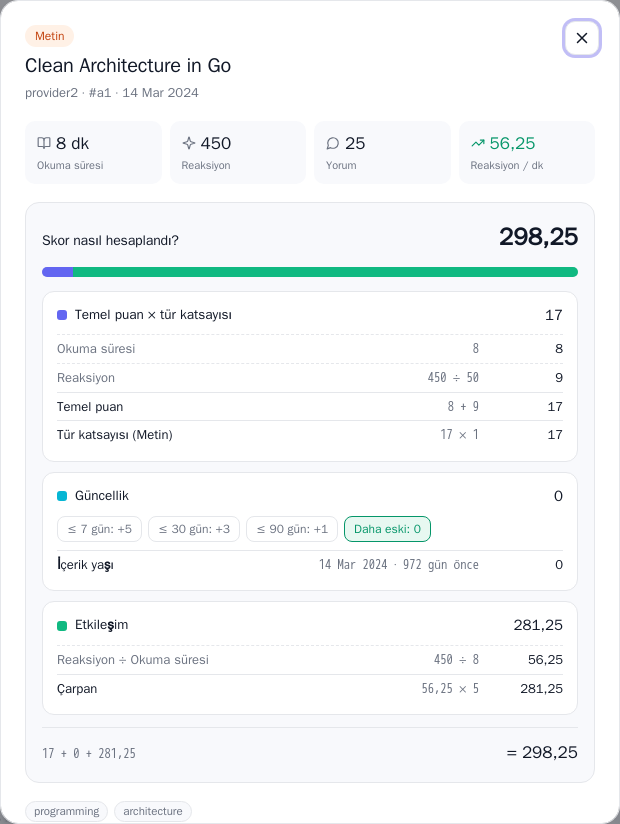

Örnek: provider1/v1 → `(15 + 12) × 1.5 + 0 + (1200/15000) × 10 = 41.3`

**Formülle ilgili gözlemler** (formül case'te tanımlandığı gibi, değiştirilmeden uygulandı):
- Metin içeriğin etkileşim puanı diğer bileşenlerden çok daha büyük ölçekte. Örnek veride tek makale 298 puan alırken videolar 33–70 arasında kalıyor. Gerçek bir sistemde bileşenlerin normalize edilmesi düşünülmeli.
- Mock verideki tüm tarihler 2024'e ait, bu yüzden bugün itibarıyla güncellik puanı 0. Testler sabit bir saat enjekte ederek tüm eşikleri doğruluyor.

---

## Arama ve Sıralama

`GET /api/v1/contents?q=&type=video|text&provider=<ad>&tag=<etiket>&published_from=YYYY-MM-DD&published_to=YYYY-MM-DD&sort=popularity|relevance&page=1&per_page=20`

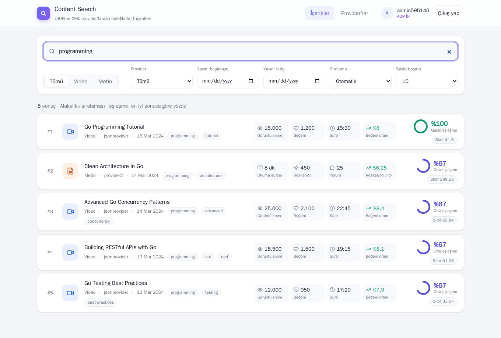

- **Anahtar kelime:** Başlık ve etiketlerde tam kelime eşleşmesi **veya** başlıkta kelimenin bir parçası. `"tam ifade"` ve `-hariç` sözdizimi desteklenir. Kullanıcı girdisindeki LIKE wildcard'ları (`%`, `_`) escape edilir.
- **Filtreler:** Hepsi birbiriyle ve anahtar kelimeyle birlikte kullanılabilir.
  - `type` ve `provider`.
  - `tag`: o etiketi taşıyan içerikler. Büyük/küçük harf duyarsız; etiketler küçük harfle saklandığı için sorgu `tags @> ARRAY[...]` şeklinde GIN index'i kullanır.
  - `published_from` / `published_to`: yayın günü aralığı (`YYYY-MM-DD`, UTC). İki uç da dahil; yalnızca biri verilirse diğer taraf açıktır. Ters aralık ya da hatalı tarih `400 invalid_input` döner.
- **Sıralama:**
  - `popularity`: `score DESC`.
  - `relevance`: yalnızca gerçek eşleşmeyi puanlar.
    - **Tam kelime eşleşmesi:** Ağırlıklı `ts_rank` ile puanlanır; başlık 1,0, etiket 0,8. Başlıkta geçen kelime etikette geçenden, ikisinde birden geçen de tekinden daha yüksek puan alır. Örneğin "programming" araması: başlığında ve etiketinde geçen %100, yalnızca etiketinde geçen dört içerik eşit şekilde %67.
    - **Kelimenin yalnızca bir parçası geçiyorsa** (ör. "kuberne"): `word_similarity` kullanılır, 0,4 ile ölçeklenir; böylece her zaman tam eşleşmelerin altında kalır.
    - **Eşitlikte** popülerlik skoru belirler; aynı şekilde eşleşen içeriklerden daha değerli olan öne çıkar.
    - **Neden başlık benzerliği eklenmiyor:** İlk sürümde `similarity(title, q)` de ekleniyordu. Bu kısa başlıkları ödüllendiriyor ve harf tesadüflerine puan veriyordu: "testing" ile "programming" ortak "ing" içerdiği için aynı şekilde eşleşen içerikler %21 ile %31 arasına saçılıyordu. Çıkarılması yaygın kelimelerde sorguyu da hızlandırdı (634 → 372 ms, 1 milyon kayıtta).
  - `sort` verilmezse: anahtar kelime varsa relevance, yoksa popularity. Anahtar kelime olmadan istenen relevance, popularity'ye düşer; `meta.sort` hangisinin kullanıldığını bildirir, dashboard da bunu bir uyarıyla gösterir.
- **Eşleşme yüzdesi (`match`):** Ham alakalılık değeri (ör. 0,7295) kullanıcıya bir şey ifade etmediği için yanıtta ayrıca alakalılığın **aramanın en iyi sonucuna göre yüzdesi** döner (en iyisi 100).
  - Referans sayfa değil bütün aramadır: 2. sayfadaki bir sonuç da aynı ölçekte görünür. Referans değer `meta.best_relevance` olarak döner.
  - **1. sayfada** en iyi sonuç zaten listenin ilk satırıdır; ek bir şey hesaplanmaz. **Sonraki sayfalarda** en iyi değer `max(relevance) OVER ()` ile bulunur. Bu, çok satırla eşleşen aramalarda sorguyu %20–50 uzatır (bkz. [Ölçeklenme Planı](#ölçeklenme-planı)); bu yüzden yalnızca orada eklenir.
  - Popülerlik sıralamasında hesaplanmaz; böylece onun index planı korunur.
  - Mutlak bir ölçek (ör. `ts_rank` normalizasyonu) seçilmedi: başlığında tam aranan kelime geçen bir içerik bile ~%25 çıkıp "kötü eşleşme" gibi görünüyordu.
- **Alakalılık kırılımı:** `GET /api/v1/contents/{id}?q=programming`, skor kırılımına ek olarak `relevance_breakdown` döndürür. Dashboard, alakalılık sıralamalı bir listeden açılan detayda bunu gösterir:
  - Aranan her kelime başlıkta ve etikette kaç kez geçiyor.
  - Tek kelimelik aramada `ts_rank`'in kendi aritmetiği: eşleşmeler ağırlığa göre sıralanır, n'inci eşleşme `ağırlık ÷ n²` katkı yapar, toplam π²/6'ya bölünür. Örnek: başlık + etiket → (1 ÷ 1² + 0,8 ÷ 2²) ÷ 1,6449 = 0,7295.
  - Birden fazla kelimede PostgreSQL kelimelerin birbirine yakınlığını da hesaba kattığı için yalnızca sonuç gösterilir. Kısmi eşleşmede `word_similarity × 0,4`.
  - Son olarak yüzde: bu içerik ÷ aramanın en iyi sonucu.

  Açıklama, sıralamayı yapan SQL'den gelir; ağırlıklar iki tarafın ortak kullandığı sabitlerdir. Testler, adımların PostgreSQL'in `ts_rank` sonucunu birebir verdiğini doğrular.

  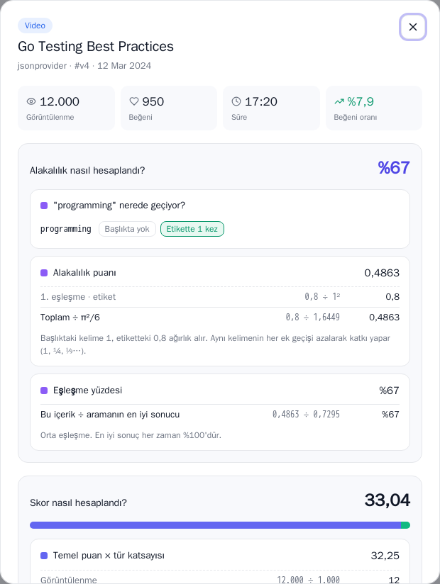

- **Sayfalama:** offset/limit. Yanıtta `meta{page, per_page, total, total_pages, sort, best_relevance}` döner.

---

## Cache Stratejisi

- **Cache-aside:** Anahtar `search:v{versiyon}:{sha256(kelime | tür | provider | etiket | başlangıç | bitiş | sıralama | sayfa | sayfa boyutu)}`, TTL 90 sn. Kelime küçük harfe çevrilerek anahtara girer. Yanıttaki `X-Cache` header'ı `HIT`, `MISS` veya `BYPASS` değerini taşır.
- **Kullanıcılar arasında paylaşılır:** Anahtar kullanıcı bilgisi içermez, çünkü sonuç kullanıcıya göre değişmez (viewer ve admin aynı listeyi görür). İki kullanıcı aynı sorguyu gönderirse ikincisi birincinin cache'lediği sonucu alır. Sonuçlar ileride kişiye göre değişirse anahtara kullanıcı kimliği eklenmelidir.
- **Versiyonlu invalidation:** Cache'i geçersiz kılmak için `search:version` sayacı `INCR` edilir. Eski anahtarlar bir daha okunmaz ve TTL dolunca silinir. Invalidation O(1) ve atomik; anahtar taraması gerekmez.
- **Sadece bir şey değiştiyse:** Sync, değişmemiş kayıtları yazmaz; skor yeniden hesaplaması da yalnızca gerçekten değişen skorları yazar. Cache, ancak bir sync bir kaydı ekleyip değiştirdiyse, gizlediyse ya da skorunu değiştirdiyse temizlenir. Provider verisi aynı kaldıkça cache sync'ler arasında korunur. Provider'ın adı değişince, açılıp kapatılınca ya da silinince de cache temizlenir.
- **Ön ısıtma (cache warming):** Cache her geçersizleştiğinde, kullanıcının hiçbir şey yazmadan gördüğü sorgular hemen yeniden hesaplanıp cache'e yazılır: her türün (tümü, video, metin) popülerliğe göre ilk sayfası, hem dashboard'un sayfa boyutuyla (10) hem API'nin varsayılanıyla (20), toplam 6 sorgu.
  - Böylece sync'ten sonra dashboard'u açan ilk kullanıcılar da cache'ten yanıt alır. Ön ısıtma birkaç milisaniye sürer, 5 sn ile sınırlıdır ve başarısız olursa yalnızca loglanır.
  - Kullanıcı araması sayılmaz, bu yüzden `search_requests_total` metriğini etkilemez.
  - `CACHE_WARM=false` ile kapatılabilir.
- **Stampede koruması:** Aynı anahtar için eşzamanlı cache miss'ler `singleflight` ile tek bir veritabanı sorgusuna indirgenir.
- **Cache'lenmeyenler (bilinçli olarak):** İçerik detayı (primary key ile tek satır; skor kırılımı o anki zamana göre hesaplanır), provider listesi ve sync geçmişi (az okunur, admin değişiklikleri hemen görünmeli), kimlik işlemleri. Provider yanıtları da cache'lenmez; veritabanına kalıcı olarak yazılır.
- **Diğer küçük cache'ler:** JWKS public key'leri gateway'de ve sse-service'te bellekte tutulur (bilinmeyen `kid`'de en erken 30 sn'de bir yeniden çekilir). Dashboard dosyaları tarayıcıda 5 dakika (`max-age=300`) cache'lenir.
- **Graceful degradation:**
  - Redis yoksa aramalar doğrudan DB'den karşılanır (`BYPASS`).
  - Gateway'deki rate limiter ve iptal kontrolü fail-open çalışır: Redis'e ulaşamazsa istekleri reddetmez.
  - JWKS key'leri bellekte cache'lendiği için iam-service kısa süre düşse bile mevcut token'lar doğrulanmaya devam eder.
  - Bu durumlarda `/readyz` `degraded` döner ama servis hazır kalır.

---

## Dashboard

Dashboard, framework ve build adımı olmadan yazılmış küçük bir arayüzdür (HTML, CSS, vanilla JS). Gateway binary'sine gömülüdür; açık ve koyu temayı sistem ayarına göre seçer ve telefon genişliğinde de çalışır.

| Giriş | Koyu tema | Telefon |
|---|---|---|
| 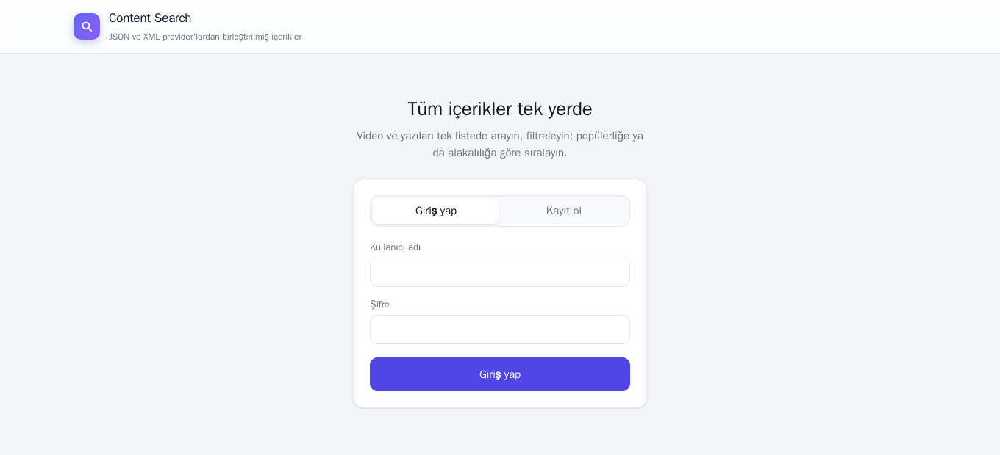 | 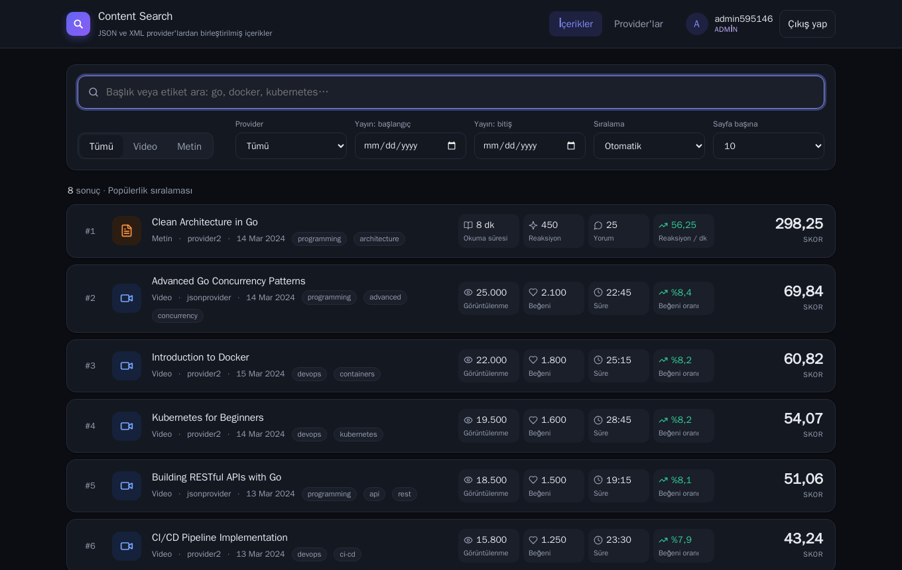 | 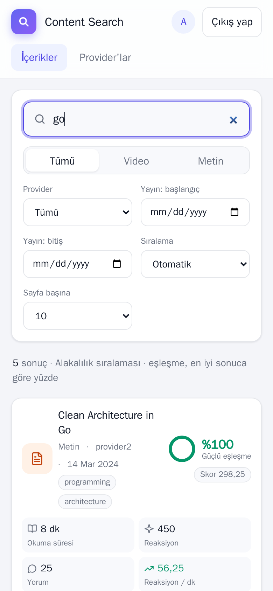 |

- **Sonuç listesi:** Her içerik bir satır kartında gösterilir: sıra, tür ikonu, başlık, provider, tarih ve etiketler. Kartın sağında listenin neye göre sıralandığı öne çıkar:
  - **Popülerlik sıralamasında** büyük puntoyla skor.
  - **Alakalılık sıralamasında** dairesel bir eşleşme göstergesi ("%67", "Güçlü / Orta / Zayıf eşleşme"); skor küçük bir "Skor 298,25" etiketine iner.

  İki sayı hiçbir zaman aynı biçimde gösterilmez, bu yüzden birbirine karışmaz.
- **Metrikler tek bakışta:** Her kartta dört metrik sütunu var. Sütunlar her satırda aynı yerde durduğu için değerler alt alta karşılaştırılabilir:

  | | 1 | 2 | 3 | 4 |
  |---|---|---|---|---|
  | Video | Görüntülenme | Beğeni | Süre | Beğeni oranı (beğeni / görüntülenme) |
  | Metin | Okuma süresi | Reaksiyon | Yorum | Reaksiyon / dk |

  Dördüncü sütun, skor formülündeki etkileşim oranıdır. Sayılar 1 milyona kadar tam yazılır; Türkçe kısaltmadaki "B" (bin) "milyar" gibi okunabildiği için kısaltma sadece milyonun üstünde kullanılır.
- **Filtreler:** Arama kutusu, tür için Tümü / Video / Metin seçimi, provider, yayın tarihi aralığı, sıralama ve sayfa boyutu; numaralı sayfalama.
  - Kartlardaki ve detay penceresindeki etiketlere tıklanınca liste o etikete göre süzülür. Etiket filtresi sonuç sayısının yanında kaldırılabilir bir rozet olarak görünür; aynı etikete tekrar tıklamak da filtreyi kaldırır.
  - Tarih alanları birbirini sınırlar, böylece ters bir aralık seçilemez.
- **Detay penceresi:** Metriklerin tam değerleri, skorun adım adım hesabı ([Puanlama](#puanlama)) ve alakalılık sıralamalı bir listeden açıldıysa alakalılığın adım adım hesabı ([Arama ve Sıralama](#arama-ve-sıralama)).
- **Provider yönetimi (admin):** Provider tablosunda format, URL, durum ve son sync sonucu ("4 kayıt · değişiklik yok", "· 2 kaldırıldı") görünür. Sync, düzenleme, etkinleştirme ve silme işlemleri ikon butonlarla yapılır. Yeni provider formunda format otomatik algılanır ve ad kuralı alanın altında açıklanır.

  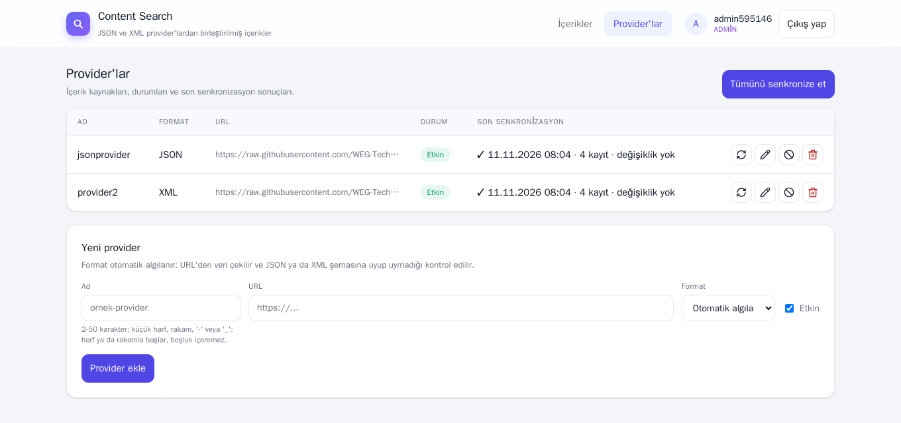

### Dashboard'da oturum

Token'lar `sessionStorage`'da tutulur: sayfa yenilense de kalır, sekme kapanınca silinir. Bir istek 401 döndüğünde access token sessizce refresh edilip istek tekrarlanır. Aynı anda gelen 401'ler tek bir refresh isteğinde birleştirilir; böylece rotasyona uğramış bir refresh token asla iki kez gönderilmez (gönderilseydi tekrar kullanım tespiti tüm oturumu kapatırdı). Kullanıcı değişince önceki kullanıcının filtreleri, sonuçları ve yarım kalan istekleri temizlenir. Admin'ler "Provider'lar" sekmesini görür; viewer'a bu sekme hiç gösterilmez, sunucu tarafında da reddedilir.

> Bilinen ödünleşim: `sessionStorage` bir XSS açığında JavaScript tarafından okunabilir. Dashboard tüm veriyi `textContent` ile basıyor ve harici script yüklemiyor. Üretimde refresh token'ı `HttpOnly` + `SameSite=Strict` bir cookie'ye taşımak daha güvenli olur.

---

## İzleme (Monitoring)

`docker compose up` ile birlikte Prometheus ve Grafana da ayağa kalkar. Dashboard'lar ve datasource `deploy/grafana` altından otomatik yüklenir; elle kurulum gerekmez.

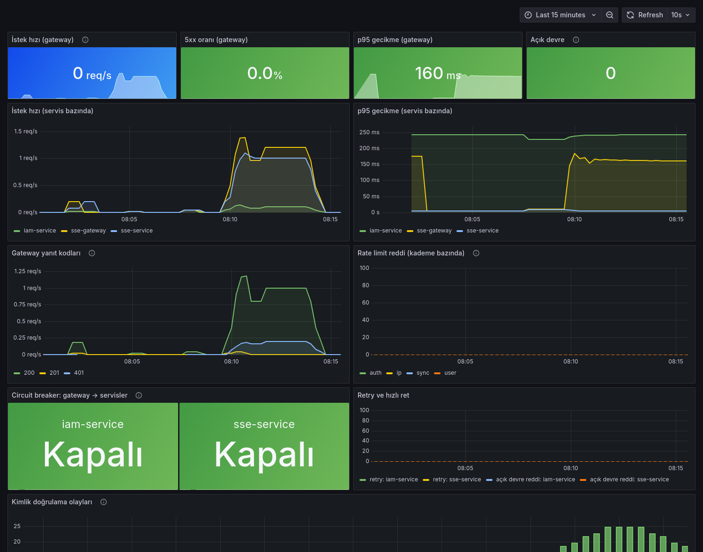

### Nasıl çalışıyor

- Her servis metriklerini **ayrı bir portta** (`METRICS_ADDR`, varsayılan `:9100`) sunar. Bu port compose dışına açılmaz, böylece `/metrics` public API portundan hiçbir zaman erişilemez.
- Prometheus üç servisi 10 saniyede bir okur ve veriyi 7 gün saklar.
- Grafana giriş istemeden dashboard'ları gösterir (anonim viewer). Düzenleme için `admin` hesabı gerekir; şifre `GRAFANA_ADMIN_PASSWORD` ile değiştirilebilir.
- Dashboard'lar elle yazılmış JSON yerine `deploy/grafana/generate.py` ile üretilir; böylece paneller tutarlı kalır. Bir paneli değiştirdikten sonra `python3 deploy/grafana/generate.py` çalıştırmak yeterli; Grafana dosyaları birkaç saniye içinde yeniden yükler.

### Dashboard'lar

**Content Search · Genel Bakış**
- Özet kutular: gateway istek hızı, 5xx oranı, p95 gecikme, açık devre sayısı.
- Servis bazında istek hızı ve p95 gecikme.
- Gateway yanıt kodları: 401/403 edge'deki yetki kontrolünü, 429 rate limit'i, 502/503/504 upstream sorunlarını gösterir.
- Kademe bazında rate limit redleri (ip, auth, user, sync).
- Gateway → servis circuit breaker durumları (Kapalı / Yarı açık / Açık), retry'lar ve açık devre yüzünden hızlıca reddedilen istekler.
- Kimlik doğrulama olayları: `invalid_credentials` patlaması şifre denemesine, `token_reused` ise çalınmış bir refresh token'a işaret eder.

**Content Search · Arama ve Senkronizasyon**
- Cache isabet oranı, saklanan içerik, etkin provider ve açık provider devresi sayıları.
- Cache durumuna göre aramalar (HIT / MISS / BYPASS) ve arama gecikmesi (p50 / p95).
- Provider bazında sync sonuçları ve sync süresi.
- Provider circuit breaker durumları.
- Provider ve türe göre içerik sayısı.

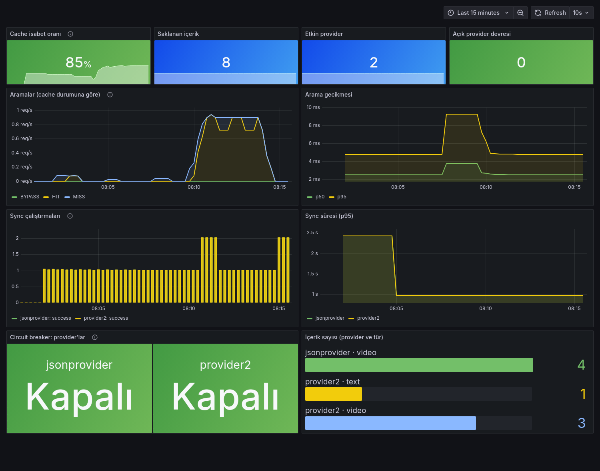

### Metrikler

| Servis | Metrik | Açıklama |
|---|---|---|
| hepsi | `http_requests_total{method,route,status}`, `http_request_duration_seconds` | İstek sayısı ve gecikme. Etiket ham path değil route kalıbıdır (`/api/v1/contents/:id`), seri sayısı sınırlı kalır |
| hepsi | `go_*`, `process_*` | Go runtime ve process metrikleri |
| gateway | `gateway_rate_limited_total{tier}` | 429 ile reddedilen istekler |
| gateway | `gateway_circuit_state{upstream}` | 0 kapalı, 1 yarı açık, 2 açık |
| gateway | `gateway_upstream_retries_total`, `gateway_circuit_rejected_total` | Retry'lar ve açık devre yüzünden hızlı redler |
| iam | `auth_events_total{event,result}` | register / login / refresh / logout sonuçları |
| sse | `search_requests_total{cache}` | HIT / MISS / BYPASS |
| sse | `sync_runs_total{provider,status}`, `sync_duration_seconds`, `sync_items_upserted_total`, `sync_items_removed_total` | Sync çalışmaları (periyodik ve manuel), yazılan ve gizlenen kayıtlar |
| sse | `contents_stored{provider,type}`, `provider_enabled`, `provider_circuit_state` | Prometheus okuduğu anda veritabanından ve breaker'lardan hesaplanır |

Notlar:
- **Kod değişikliği gerektirmeyen tasarım:** Servis metrikleri, gözlenen bileşenleri saran decorator'lar ile toplanır (`telemetry` paketleri). Arama servisi, sync store ve auth use case'inin koduna dokunulmadı.
- **Sayaçlar sıfırdan başlar:** Bilinen etiket kombinasyonları (rate limit kademeleri, cache durumları, beklenen auth sonuçları) servis açılırken 0 değeriyle oluşturulur. İlk değeri 1 olarak ortaya çıkan bir sayacın artışını `increase()`/`rate()` göremez ve ilk olay grafikte kaybolurdu.
- **Circuit durumları:** Grafana 11'in state-timeline paneli sayısal durumlarda value mapping'leri yok sayıyor. Bu yüzden durumlar renkli stat kutularıyla gösteriliyor.

---

## Testler

```bash
make test               # unit testler (DB gerektirmez)
make test-integration   # + PostgreSQL ve Redis üzerinde integration testler
```

Üç modülde toplam 178 test fonksiyonu var (tablo bazlı alt testler hariç). Integration testleri her çalıştırmada geçici bir veritabanı oluşturup sonunda siler. CI (GitHub Actions) her modül için vet, golangci-lint ve tüm testleri Postgres/Redis servisleriyle çalıştırır.

| Servis | Katman | Ne test ediliyor |
|---|---|---|
| iam | `auth` | Register validasyonu ve rol varsayılanı, kullanıcı adı normalizasyonu, hatalı şifre, refresh rotasyonu, tekrar kullanımda oturumun tamamen iptali, süresi dolmuş token, logout; token'ların oturum taşıması, logout'ta ve çalınmış token'da oturumun iptal listesine yazılması, liste yazılamazsa logout'un yine başarılı olması |
| iam | `pkg/jwtauth` | İmzala/doğrula; süresi dolmuş, yanlış audience/issuer, bilinmeyen key, **HS256 algoritma karışıklığı** saldırısı; JWK dönüşümü; middleware 401/403; iptal edilen oturumun reddi; *(integration)* Redis'te iptal listesinin yazılıp okunması ve süresi |
| iam | `http/router` | Register → login → me → refresh → logout akışı uçtan uca; hata kodları; JWKS'te private bilgi olmaması |
| iam | `repository` *(integration)* | Kullanıcı adı tekilliği, refresh token tüketme / tekrar kullanım / süre dolumu, aile iptali, logout'ta oturumun bulunması |
| sse | `domain`, `scoring` | Sorgu normalizasyonu ve filtre validasyonu; formülün bütün bileşenleri, eşikler, sıfıra bölme; skor ve alakalılık açıklamalarının hesapla birebir aynı olması (`ts_rank` adımları) |
| sse | `provider`, `jsonprovider`, `xmlprovider`, `registry` | Adapter'lar (gerçek mock yanıtlarıyla), normalizasyon; sayfalama (toplam, kısa/boş sayfa, sayfa limiti, sayfa parametresini yok sayan provider, hatalı sayfa); format algılama; breaker'ın provider ve URL başına olması |
| sse | `ingest` | Provider izolasyonu, eşzamanlı sync reddi, devre dışı provider'lar; gizleme yalnızca tam ve eksiksiz akışta; cache'in yalnızca değişiklikte temizlenmesi |
| sse | `service/search`, `service/providers` | Cache-aside, versiyonlu invalidation, singleflight, Redis kesintisinde bypass, ön ısıtma, cache anahtarının bütün filtreleri kapsaması; provider validasyonu ve format algılama |
| sse | `http/router` | **Yetki matrisi:** her endpoint için anonim / viewer / admin durum kodları; validasyon; tarih parametreleri; skor ve alakalılık kırılımının yanıta ulaşması |
| sse | `pkg/httpclient`, `pkg/cache`, `pkg/jwtauth` | Rate limit, retry, `Retry-After`; provider circuit breaker'ı; bellek ve Redis cache; JWKS cache'leme, rate limitli yeniden çekme, iam kesintisinin 503 olarak bildirilmesi, iptal edilen oturumlar |
| sse | `repository` *(integration)* | Upsert ve değişmeyen satırın hiç yazılmaması, FTS ve alakalılık kuralları, eşleşme yüzdesinin bütün aramaya göre olması, alakalılık açıklamasının PostgreSQL ile birebir tutması, etiket ve tarih filtreleri, gizleme ve geri gelme, skorların yalnızca değişince yazılması, provider CRUD ve foreign key'ler |
| gateway | `http/router` | Her path'in doğru servise gitmesi; path/query/body/Authorization'ın iletilmesi; istemcinin gönderdiği `X-Forwarded-For`'un ezilmesi; request-id; tanımsız path'ler; upstream kapalıyken 502; **edge yetki matrisi**; auth, IP, kullanıcı ve sync limitleri; açık devrenin yalnızca kendi servisini etkilemesi |
| gateway | `http/middleware` | JWT ve rol kontrolleri, okuma/yazma ayrımı, JWKS kesintisinde 503; idempotent isteklerin tekrar denenmesi, yazma isteklerinin ve timeout'ların denenmemesi, devrenin açılıp yarı açık denemeyle kapanması, `500`'ün devreyi açmaması, backoff'un üst sınırı ve jitter'ı; metrikler |
| gateway | `pkg/ratelimit`, `pkg/jwtauth` | Pencere başına limit, özel anahtar, iç içe limitlerde en sıkı header; iptal edilen oturumun reddi ve Redis kesintisinde fail-open |
| hepsi | `pkg/metrics`, `telemetry` | Route kalıbıyla etiketleme, sayaçlar, scrape anında okunan durumlar ve DB hatasında scrape'in bozulmaması, sayaçların sıfırdan başlaması |

Ayrıca `scripts/search-benchmark/`, arama sorgularını 1 milyon kayıtta ölçer (bkz. [Ölçeklenme Planı](#ölçeklenme-planı)).

---

## Konfigürasyon

Her servis environment variable ile yapılandırılır. Compose'un okuduğu değişkenler için [`.env.example`](.env.example) dosyasına bakın.

Her servis ayrıca `METRICS_ADDR` (varsayılan `:9100`) ile Prometheus metriklerini sunduğu ayrı adresi alır. Compose tarafında `PROMETHEUS_PORT` (9090), `GRAFANA_PORT` (3000) ve `GRAFANA_ADMIN_PASSWORD` (`admin`) ayarlanabilir.

**sse-gateway**

| Değişken | Varsayılan | Açıklama |
|---|---|---|
| `IAM_URL`, `SSE_URL` | *(zorunlu)* | Upstream servis adresleri |
| `UPSTREAM_TIMEOUT` | `30s` | Upstream'e yapılan her denemenin zaman aşımı |
| `JWKS_URL` | *(zorunlu)* | iam-service'in public key adresi |
| `JWT_ISSUER` / `JWT_AUDIENCE` | `iam-service` / `sse` | iam-service ile aynı olmalı |
| `REDIS_URL` | boş | Paylaşımlı rate limit sayaçları ve iptal edilen oturumlar |
| `IP_RATE_LIMIT_MAX` / `IP_RATE_LIMIT_WINDOW` | `300` / `1m` | Tüm `/api` istekleri için IP başına limit |
| `AUTH_RATE_LIMIT_MAX` / `AUTH_RATE_LIMIT_WINDOW` | `10` / `1m` | login, register ve refresh için IP başına limit |
| `USER_RATE_LIMIT_MAX` / `USER_RATE_LIMIT_WINDOW` | `100` / `1m` | Kullanıcı başına limit |
| `SYNC_RATE_LIMIT_MAX` / `SYNC_RATE_LIMIT_WINDOW` | `5` / `1m` | Kullanıcı başına sync tetikleme limiti |
| `BREAKER_FAILURE_THRESHOLD` | `5` | Devreyi açan ardışık hata sayısı |
| `BREAKER_OPEN_TIMEOUT` | `30s` | Devrenin açık kalma süresi |
| `BREAKER_HALF_OPEN_REQUESTS` | `1` | Yarı açık durumda izin verilen deneme isteği |
| `UPSTREAM_MAX_RETRIES` | `2` | `GET`/`HEAD` için ek deneme sayısı (`0` kapatır) |
| `UPSTREAM_BASE_BACKOFF` / `UPSTREAM_MAX_BACKOFF` | `100ms` / `1s` | Exponential backoff başlangıcı ve üst sınırı |

**iam-service**

| Değişken | Varsayılan | Açıklama |
|---|---|---|
| `DATABASE_URL` | *(zorunlu)* | |
| `JWT_PRIVATE_KEY` / `JWT_PRIVATE_KEY_FILE` | boş | PEM formatında RSA anahtarı. Boşsa geçici bir anahtar üretilir |
| `JWT_ISSUER` / `JWT_AUDIENCE` | `iam-service` / `sse` | |
| `ACCESS_TOKEN_TTL` / `REFRESH_TOKEN_TTL` | `15m` / `168h` | |
| `BCRYPT_COST` | `12` | |
| `REDIS_URL` | boş | İptal edilen oturumların listesi; gateway ve sse-service aynı listeyi okur. Boşsa logout sonrası access token'lar süreleri dolana kadar geçerli kalır |

**sse-service**

| Değişken | Varsayılan | Açıklama |
|---|---|---|
| `DATABASE_URL` | *(zorunlu)* | |
| `JWKS_URL` | *(zorunlu)* | iam-service'in public key adresi |
| `JWT_ISSUER` / `JWT_AUDIENCE` | `iam-service` / `sse` | iam-service ile aynı olmalı |
| `REDIS_URL` / `CACHE_TTL` | boş / `90s` | Arama cache'i ve iptal edilen oturumlar |
| `CACHE_WARM` | `true` | Cache geçersizleşince varsayılan aramaları önceden hesapla |
| `SYNC_INTERVAL` | `10m` | Periyodik senkronizasyon aralığı |
| `PROVIDER_RATE_PER_SEC` / `PROVIDER_BURST` | `2` / `1` | Provider başına istek limiti |
| `PROVIDER_MAX_RETRIES` / `PROVIDER_TIMEOUT` | `3` / `5s` | |
| `PROVIDER_MAX_PAGES` | `50` | Bir fetch'te takip edilen en fazla sayfa |
| `PROVIDER_BREAKER_FAILURE_THRESHOLD` | `5` | Provider devresini açan ardışık başarısız istek sayısı (`0` kapatır) |
| `PROVIDER_BREAKER_OPEN_TIMEOUT` | `15m` | Provider devresinin açık kalma süresi |
| `SCORE_VIDEO_COEFFICIENT` / `SCORE_TEXT_COEFFICIENT` | `1.5` / `1.0` | |

---

## Teknoloji Tercihleri ve Gerekçeleri

### Go + Fiber
- **Go:** Eşzamanlılık modeli provider'ları paralel çekmeye uygun. Tek statik binary üretmesi de servis başına küçük bir distroless imaj demek.
- **Fiber:** fasthttp üzerinde çalışıyor ve gereken parçaları hazır getiriyor: rate limiter, request-id, recover, reverse proxy.
- **`Immutable: true`:** fasthttp request buffer'larını yeniden kullandığı için açık. Böylece handler'dan dışarı çıkan string'ler güvenli kalıyor (cache anahtarları, singleflight, proxy).

### Neden üç servis
Kimlik yönetimi ile içerik araması farklı hızlarda değişen, farklı güvenlik gereksinimleri olan iki alan:
- **Private key izolasyonu:** İmzalama anahtarı yalnızca iam-service'te kalıyor.
- **Bağımsız ölçekleme:** Arama yükü arttığında yalnızca sse-service ölçeklenebiliyor.
- **Tek giriş noktası:** Gateway sayesinde istemci tek bir origin görüyor (CORS gerekmiyor). Token doğrulama, rate limit ve circuit breaker gibi edge görevleri de tek yerde toplanıyor.

### PostgreSQL (MongoDB ve Elasticsearch yerine)

| İhtiyaç | PostgreSQL ile karşılanma şekli |
|---|---|
| Kalıcı veri tutarlılığı | ACID transaction'lar; `UNIQUE`, `CHECK` ve foreign key kısıtları. Provider batch'i tek transaction'da upsert edilir |
| Anahtar kelime araması | Başlık (ağırlık A) ve etiketler (ağırlık B) üzerinde `tsvector` generated column + GIN index |
| Alakalılık skoru | Tam kelime eşleşmesinde ağırlıklı `ts_rank`, kelime parçasında `pg_trgm word_similarity` |
| Kısmi eşleşme ("kubern" → Kubernetes) | `pg_trgm` GIN index ile `ILIKE` |
| Popülerliğe göre sıralama | Önceden hesaplanmış `score` kolonu + `(score DESC, id)` ve `(type, score DESC, id)` index'leri |
| Etiket filtresi | `TEXT[]` kolonu + GIN index |
| Token rotasyonu | Tek bir koşullu `UPDATE` ile atomik "tüket" işlemi |

- **MongoDB:** Formatlar arası farklar zaten mapper katmanında normalize ediliyor, bu yüzden şema esnekliği belirleyici değil. Ayrıca Mongo'nun text search'ü koleksiyon başına tek index'le sınırlı ve kısmi eşleşme yapamıyor. Çok dokümanlı transaction için de replica set gerekiyor.
- **Elasticsearch:** Bu veri hacminde Postgres FTS yeterli. Veri milyonlara çıkarsa ES bir read model olarak eklenebilir; Postgres kaynak veri olarak kalır, ES `ContentSearcher` interface'inin arkasına yerleşir ve servis katmanı değişmez (bkz. [Ölçeklenme Planı](#ölçeklenme-planı)).

### Redis
- **sse-service:** Arama sonuçlarının paylaşımlı cache'i.
- **Gateway:** Instance'lar arasında paylaşılan rate limit sayaçları.
- **Üç servis:** İptal edilmiş oturumlar listesi.

Redis hepsi için opsiyoneldir; ulaşılamazsa sistem çalışmaya devam eder (bkz. [Cache Stratejisi](#cache-stratejisi)).

### Diğer
- `pgx/v5`: PostgreSQL driver'ı.
- `goose`: Migration'lar binary'ye gömülü, açılışta otomatik uygulanır.
- `golang-jwt/jwt/v5`: Token imzalama ve doğrulama.
- `x/crypto/bcrypt`: Şifre hash'leme.
- `x/time/rate`: Provider başına token bucket.
- `sony/gobreaker`: Circuit breaker.
- `prometheus/client_golang`: Metrikler.
- `log/slog`: Yapısal JSON log. Gateway'in ürettiği `X-Request-ID` tüm servislerin loglarında görünür.
- `testify`: Test assertion'ları.

---

## Ölçeklenme Planı

### Ölçüm: 1 milyon kayıtta arama
`scripts/search-benchmark/` script'leri, `contents` tablosunun aynısını (aynı kolonlar, otomatik arama sütunu ve index'ler) ayrı bir şemada 1 milyon sentetik kayıtla kurar ve servisin çalıştırdığı SQL'i (sayım + 20'lik sayfa) ölçer. Kelime dağılımı bilerek zorlayıcıdır: "go" kayıtların %28'inde, "docker" %9'unda geçer.

| Senaryo | Sayım | Sayfa | Toplam |
|---|---|---|---|
| Kelimesiz, popülerlik, 1. sayfa | 194 ms | ~0 ms | ~0,2 sn |
| Kelimesiz, popülerlik, 5000. sayfa (offset 100 bin) | 194 ms | 210 ms | ~0,4 sn |
| `q=go` (%28), alakalılık, 1. sayfa | 330 ms | 372 ms | **~0,7 sn** |
| `q=go`, alakalılık, 2. sayfa (eşleşme yüzdesi için `max() OVER ()`) | 328 ms | 477 ms | ~0,8 sn |
| `q=docker` (%9), alakalılık | 110 ms | 123 ms | ~0,23 sn |
| Nadir kelime (769 kayıt), alakalılık | 3 ms | 3 ms | 6 ms |
| `q=go`, popülerlik | 325 ms | ~0 ms | ~0,3 sn |
| Kelimenin bir parçası (`kuberne`) | 103 ms | 196 ms | ~0,3 sn |
| Etiket filtresi | 16 ms | 4 ms | 20 ms |

Süreler cache'te olmayan istek içindir; cache'ten dönen istek birkaç ms sürer. Docker'ın paylaşımlı bellek sınırı nedeniyle paralel sorgu kapalıydı; gerçek bir sunucuda süreler daha kısa olur, ama veriyle doğrusal büyüme değişmez.

**Bulgular:**
- **Alakalılık sıralaması bütün eşleşmeleri puanlar.** Index eşleşen satırları hızlı bulur, ama "en alakalı 20"yi bulamaz. `ts_rank` her eşleşmede hesaplanıp sıralanır, yani süre eşleşme sayısıyla doğrusal büyür. 10 milyon kayıtta yaygın bir kelime ~5–7 sn sürer.
- **`COUNT(*)` maliyetin yaklaşık yarısıdır.** Popülerlik sıralamasında sayfa index'ten anında gelir; süreyi toplam sayım belirler.
- **Derin sayfalar:** Offset, önceki satırları okuyup atar. Alakalılıkta 2. sayfa ve sonrası, eşleşme yüzdesinin referansı için ayrıca en iyi değeri hesaplar (%25–50).

### Plan

| Aşama | Ne zaman | Adım | Beklenen etki |
|---|---|---|---|
| 1 | ~1M kayıt | **Sayımı sınırla:** en fazla 10.001 satır say, "10.000+" göster; ya da planner tahminini kullan | Her aramada %30–50 kazanç |
| 1 | ~1M kayıt | **Keyset sayfalama:** "son görülen (skor, id)'den sonrası" | Derin sayfalar 1. sayfa kadar hızlı |
| 1 | ~1M kayıt | **Eksik index'ler:** `published_at` için B-tree, `WHERE removed_at IS NULL` koşullu index'ler | Tarih filtresi ve gizlenen kayıtların bol olduğu durumlar |
| 2 | ~5M kayıt | **Aday kümesini sınırla:** çok yaygın kelimelerde alakalılığı bütün eşleşmeler yerine, popülerlik index'inden gelen en iyi birkaç bin aday içinde hesapla. Sonuç anlamı biraz değişir: çok popüler olmayan bir tam eşleşme kaçabilir. | Yaygın kelimelerde süre eşleşme sayısından bağımsızlaşır |
| 2 | ~5M kayıt | **Eşleşme referansını cache'le:** 1. sayfada bulunan en iyi alakalılık değerini cache'leyip sonraki sayfalarda yeniden kullan | 2. sayfa ve sonrasında %25–50 kazanç |
| 2 | ~5M kayıt | **`rum` index'i:** kelime konumlarını index'te tutar; en alakalı k sonuç doğrudan index'ten gelir | Sıralama eşleşme sayısından bağımsızlaşır (eklenti kurulumu gerekir) |
| 3 | 10M+ kayıt | **Ayrı arama motoru:** Elasticsearch / OpenSearch / Meilisearch read model olarak; PostgreSQL kaynak veri olarak kalır, sync arama motorunu da besler | BM25 + block-max WAND ile "en iyi k sonuç"; dil desteği (kök bulma); yatay ölçekleme |

Arama bir arayüzün (`ContentSearcher`) arkasında olduğu için 2. ve 3. aşamalar servis ve API değişmeden yapılabilir.

Arama dışındaki ölçeklenme notları:
- Birden fazla sse-service instance'ında periyodik sync'in tek kopyada çalışması için Postgres advisory lock kullanılabilir. Provider circuit breaker'ları da o durumda instance'lar arasında paylaşılmalı.
- Paralel sorgu için paylaşımlı bellek yeterli olmalı (Docker'da `shm_size`).

---

## Bilinen Sınırlamalar ve Geliştirme Fikirleri

- **Serbest rol seçimi:** Yukarıda anlatıldığı gibi demo amaçlı. Gerçek bir sistemde admin yetkisi ayrı bir kanaldan verilmeli.
- **SSRF:** Admin'in eklediği provider URL'leri için iç ağ adresleri engellenmiyor (yalnızca `http`/`https` şeması zorunlu).
- **Provider şemaları:** "json" ve "xml" adapter'ları aslında case'in iki mock'unun şemasına özel; alan adları farklı bir JSON provider için yeni bir adapter ya da yapılandırılabilir alan eşlemesi gerekir.
- **Refresh token'ın saklandığı yer:** Dashboard'da `HttpOnly` cookie'ye taşınabilir.
- **Kullanıcı yönetimi:** Rol değiştirme, kullanıcı silme ve şifre sıfırlama endpoint'leri yok. Süresi dolmuş refresh token'lar için periyodik bir temizlik job'ı eklenebilir.
- **Dil desteği:** Arama `simple` sözlüğüyle yapılıyor; kök bulma olmadığı için "program" ile "programming" kelime eşleşmesinde aynı sayılmıyor (başlıkta kelime parçası olarak yakalanıyor).
- **Ölçeklenme:** Ölçüm ve aşamalı plan için bkz. [Ölçeklenme Planı](#ölçeklenme-planı).
- **Gözlemlenebilirlik:** OpenTelemetry tracing eklenebilir; request-id altyapısı hazır. Prometheus'a alert kuralları (örneğin açık devre, 5xx oranı, `token_reused`) ve Alertmanager eklenebilir.
